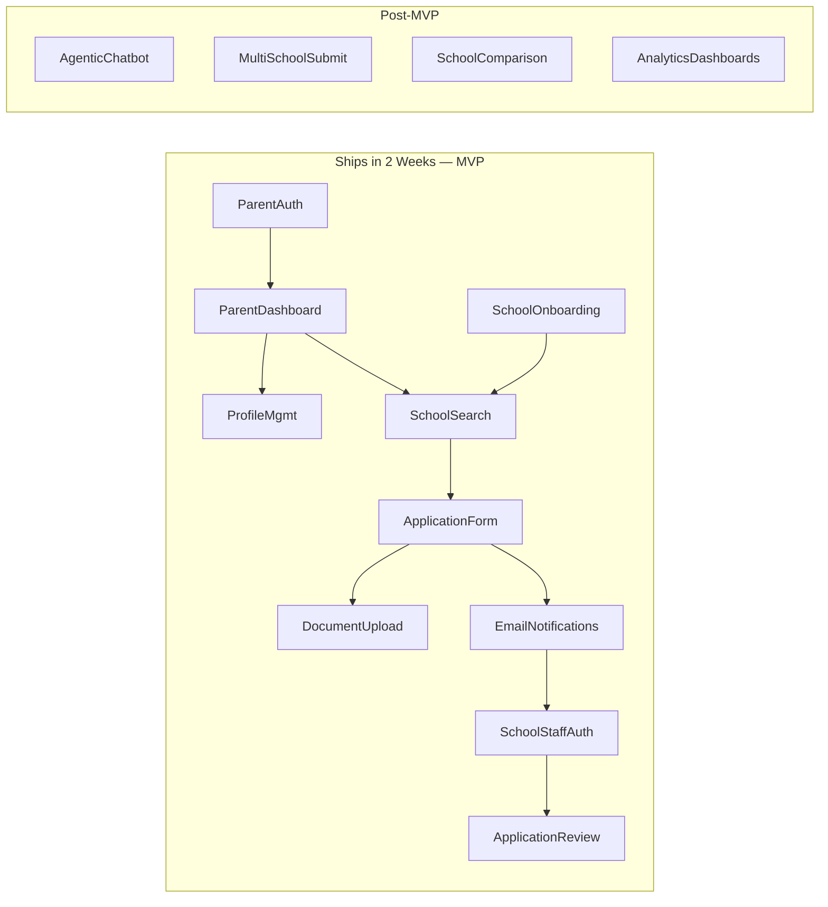
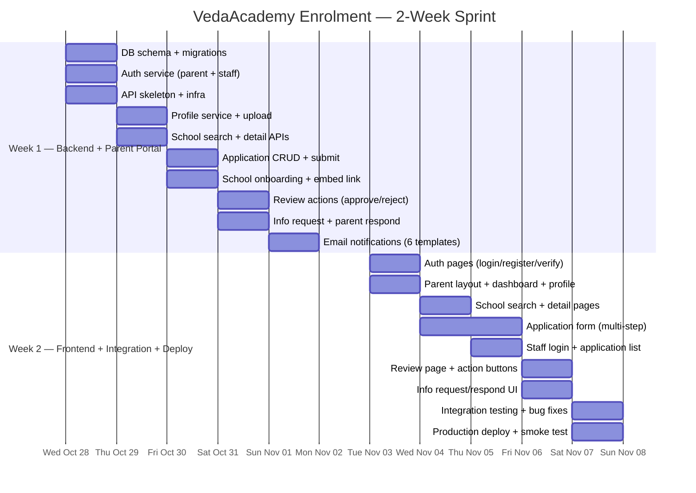
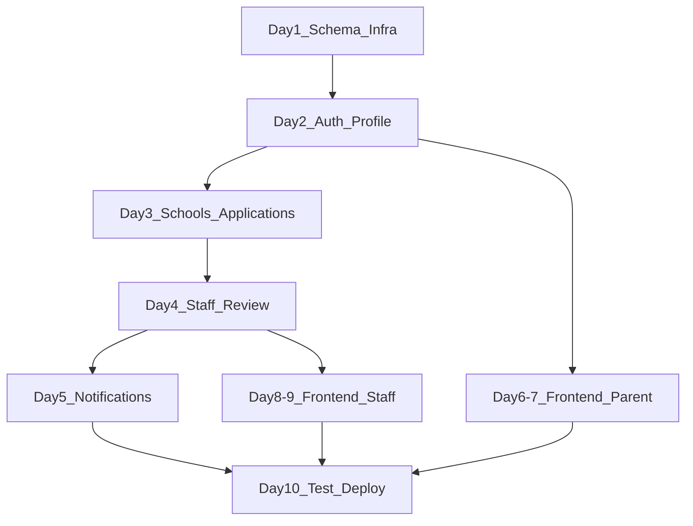
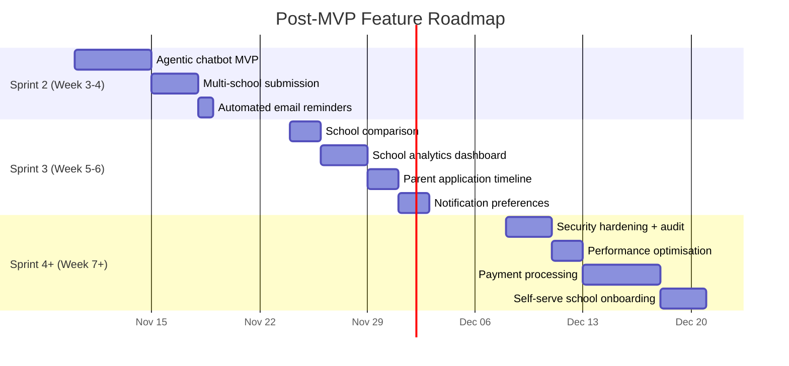

# VedaAcademy Enrolment Module — Master Roadmap

**Document Version:** 2.0
**Date:** October 2026
**Status:** Draft — planning artifact
**Audience:** Product, Engineering, Leadership
**Related:** [INDEX.md](INDEX.md), [ARCHITECTURE_AND_FLOWS.md](ARCHITECTURE_AND_FLOWS.md), [Phase1/Phase1_Architecture.md](Phase1/Phase1_Architecture.md)

This is the master index for the Enrolment microservice. Feature detail lives in the phase-specific documents. Architecture and data flows live in `ARCHITECTURE_AND_FLOWS.md`. Sequence diagrams live in `diagrams/`.

> **v2.0 change:** Compressed from 10-week/3-phase plan to **2-week aggressive sprint**. Agentic chatbot, multi-school submission, school comparison, and analytics dashboards moved to Post-MVP. The 2-week target delivers a fully functional School-First enrolment flow end-to-end.

---

## Table of Contents

1. [North star and decisions](#1-north-star-and-decisions)
2. [What ships vs what's deferred](#2-what-ships-vs-whats-deferred)
3. [Domain map](#3-domain-map)
4. [2-week delivery plan](#4-2-week-delivery-plan)
5. [Day-by-day breakdown](#5-day-by-day-breakdown)
6. [Architectural waves](#6-architectural-waves)
7. [Slice dependency table](#7-slice-dependency-table)
8. [Parallel workstreams](#8-parallel-workstreams)
9. [Risks and mitigations](#9-risks-and-mitigations)
10. [Success criteria](#10-success-criteria)
11. [Post-MVP roadmap](#11-post-mvp-roadmap)

---

## 1. North star and decisions

VedaAcademy Enrolment is a **standalone microservice**. Parents apply through a central portal; schools review applications through their own authenticated view. No organisation or tenant is created per parent.

**2-week constraint changes these decisions:**

| Decision | Choice | Rationale for 2-week scope |
|----------|--------|----------------------------|
| Standalone microservice | Yes — unchanged | Core requirement; non-negotiable |
| School-First flow only | **Yes — agentic deferred** | Manual form is fully functional without AI; chatbot is additive |
| Single-school submission | **Yes — multi-school deferred** | One school per application in MVP; multi-school needs eligibility engine |
| School comparison | **Deferred** | Requires enriched school profiles; not blocking |
| Analytics dashboards | **Deferred** | Need data volume first; schools can see application list |
| Notification preferences | **Deferred** | All notifications immediate in MVP; preferences are polish |
| Advanced document categories | **Deferred** | Simple file upload works; categorisation is refinement |
| Automated reminders | **Deferred** | Core email notifications ship; cron-based reminders are post-MVP |
| Self-serve school onboarding | **Deferred** | Platform admin onboards schools via API; self-serve is post-MVP |

---

## 2. What ships vs what's deferred

### Ships in 2 weeks (MVP)

| Feature | Description |
|---------|-------------|
| Parent registration + email verification | Email + password, verification link |
| Parent profile (mandatory fields) | Name, phone, ID proof upload |
| Parent dashboard | 3 menu items: Dashboard, Enrolment, Profile |
| School search | Filter by board, area, name |
| School-First application | Select school → multi-step form → upload docs → submit |
| School onboarding | Platform admin registers school + staff via API |
| School staff auth + RBAC | Login, school-scoped JWT, reviewer/admin/viewer roles |
| Application review | Approve / reject / request additional info |
| Parent follow-up | Respond to info requests, upload docs |
| Email notifications | 6 core templates (verify, received, approved, rejected, info-req, info-provided) |
| Embed link | Signed URL for school websites |
| Security basics | HTTPS, bcrypt, JWT, rate limiting, school-scoped isolation |
| Production deploy | Fly.io + Neon + R2 + Resend |

### Deferred to Post-MVP

| Feature | Estimated Effort | Priority |
|---------|-----------------|----------|
| Agentic chatbot application | 1 week | P1 — first post-MVP |
| Multi-school submission | 3 days | P1 |
| School comparison | 2 days | P2 |
| Analytics dashboards (school + platform) | 3 days | P2 |
| Notification preferences + digests | 2 days | P3 |
| Automated reminders (7-day, deadline) | 1 day | P2 |
| Advanced document categories | 1 day | P3 |
| Payment processing | 1 week | P3 |
| Sibling linking, waitlist | 1 week | P4 |

---

## 3. Domain map



---

## 4. 2-week delivery plan



| Week | Focus | Outcome |
|------|-------|---------|
| **Week 1** (Days 1–5) | All backend APIs, database, auth, email, services | Every API endpoint callable and tested via Swagger |
| **Week 2** (Days 6–10) | All frontend pages, integration, deploy | End-to-end: parent applies on browser → school reviews → decision made |

---

## 5. Day-by-day breakdown

### Week 1 — Backend Sprint

| Day | Date | Morning (4h) | Afternoon (4h) | Exit Criteria |
|-----|------|-------------|-----------------|---------------|
| **D1** | Oct 28 (Mon) | DB schema: all 11 tables + Alembic migrations + indexes | FastAPI skeleton, Docker Compose, R2 bucket, Redis, Resend config | `docker compose up` runs; schema migrated; health endpoint returns 200 |
| **D2** | Oct 29 (Tue) | Parent auth: register, verify-email, login, refresh JWT | Profile CRUD, ID proof upload to R2, profile-gate middleware | Parent can register → verify → login → complete profile (via Swagger) |
| **D3** | Oct 30 (Wed) | School search (board/area/name), school detail, school onboarding API | Application CRUD: create, update draft, upload documents, submit | Schools searchable; parent can create + submit application |
| **D4** | Oct 31 (Thu) | Staff auth (login, school-scoped JWT), embed link generation | Review actions: approve, reject, request-info; review history (append-only) | Staff can log in and act on applications; actions recorded |
| **D5** | Nov 1 (Fri) | Parent follow-up: respond to info request, upload docs | Email notifications: 6 templates, delivery + retry logic, secure links | Full backend lifecycle complete; all emails sending |

### Week 2 — Frontend + Integration Sprint

| Day | Date | Morning (4h) | Afternoon (4h) | Exit Criteria |
|-----|------|-------------|-----------------|---------------|
| **D6** | Nov 3 (Mon) | Auth pages: Login, Register, Verify Email, Password Reset | Parent layout (sidebar: Dashboard/Enrolment/Profile), Dashboard page | Parent can register and log in via browser |
| **D7** | Nov 4 (Tue) | Profile form with validation + ID proof upload component | School search page with filters + school detail page | Parent can complete profile, search schools |
| **D8** | Nov 5 (Wed) | Multi-step application form (5 steps) + document upload | Staff login page + application list page (school-scoped) | Parent can fill and submit application; staff can see it |
| **D9** | Nov 6 (Thu) | Application review page + approve/reject/request-info buttons | Info request dialog + parent response page + status tracking | Full review cycle works in browser |
| **D10** | Nov 7 (Fri) | Integration testing: 5 E2E scenarios; bug fixes | Production deploy (Fly.io + Neon + R2); DNS; smoke test | **smartschooladmissions.com is live** |

---

## 6. Architectural waves



| Wave | Days | What must exist | What this wave delivers |
|------|------|-----------------|------------------------|
| 1 | D1 | Nothing (greenfield) | Running DB, API skeleton, Docker Compose, storage, email config |
| 2 | D2 | Wave 1 | Parent + staff auth, profile management, file upload |
| 3 | D3 | Wave 2 | School registry, search, application form, submit |
| 4 | D4 | Wave 3 | Staff login, school-scoped review, approve/reject/request-info |
| 5 | D5 | Wave 4 | Email notifications, parent follow-up, secure links |
| 6 | D6–D7 | Wave 2 APIs | Frontend: auth, parent portal, profile, search, application form |
| 7 | D8–D9 | Wave 4 APIs | Frontend: staff portal, review page, info-request workflow |
| 8 | D10 | Waves 6+7 | Integration tests, production deploy, go-live |

---

## 7. Slice dependency table

| Slice | Name | Hard depends on | Duration |
|-------|------|-----------------|----------|
| S1 | Schema + Infra | Nothing | D1 (morning) |
| S2 | API skeleton + Docker | Nothing | D1 (afternoon) |
| S3 | Parent auth | S1 schema | D2 (morning) |
| S4 | Staff auth | S1 schema | D2 (can parallel with S3) |
| S5 | Profile service | S3 parent auth | D2 (afternoon) |
| S6 | School search + onboarding | S1 schema | D3 (morning; parallel with S5) |
| S7 | Application CRUD + submit | S3 + S6 | D3 (afternoon) |
| S8 | Review actions | S4 + S7 | D4 |
| S9 | Info request + follow-up | S8 | D4 (afternoon) |
| S10 | Email notifications | S7 + S8 + S9 | D5 |
| S11 | Embed link | S6 | D4 (parallel with S8) |
| F1 | Auth pages | S3 API ready | D6 |
| F2 | Parent portal pages | S5 + S6 + S7 APIs | D6–D8 |
| F3 | Staff portal pages | S8 + S9 APIs | D8–D9 |
| F4 | Integration + deploy | F2 + F3 complete | D10 |

---

## 8. Parallel workstreams

With 2+ developers, significant parallelism is possible:

```
Developer A (Backend-heavy)          Developer B (Frontend-heavy)
─────────────────────────────        ─────────────────────────────
D1: Schema + migrations              D1: Docker Compose, R2, Redis, Resend setup
D2: Parent auth + profile            D2: Staff auth + school onboarding API
D3: Application CRUD + submit        D3: School search + detail APIs
D4: Review actions + info-request    D4: Email templates + notification service
D5: Integration tests (backend)      D5: Embed link + secure URL generation
D6: Bug fixes + API polish           D6: Auth pages + parent layout
D7: Staff review page                D7: Profile form + school search UI
D8: Application form (multi-step)    D8: Application list + status tracking
D9: Review page + action buttons     D9: Info request/respond UI
D10: Production deploy               D10: Smoke test + bug fixes
```

**Solo developer:** Follow the day-by-day plan in §5 sequentially. Week 1 = backend, Week 2 = frontend + deploy.

---

## 9. Risks and mitigations

| # | Risk | Impact | Mitigation |
|---|------|--------|------------|
| R1 | Application form too complex for 1 day | Blocks D8 | Simplify to 3 steps instead of 5; reduce optional fields; use react-hook-form for speed |
| R2 | Email deliverability delays | Schools miss notifications | Test Resend on D1; verify domain DNS early; fallback to console logging for dev |
| R3 | Auth/JWT bugs on Day 2 | Blocks all subsequent work | Use proven patterns (python-jose, passlib); write auth tests first |
| R4 | Frontend takes longer than backend | Misses D10 deploy | Cut UI polish ruthlessly; functional > pretty; use shadcn/ui defaults everywhere |
| R5 | Production deploy issues on D10 | Misses deadline | Do a staging deploy on D8 evening; fix issues on D9; D10 = final deploy |
| R6 | Scope creep during sprint | Blows timeline | Hard rule: if it's not in the "Ships in 2 weeks" table, it doesn't get built |

### Cut-if-behind fallbacks

If behind schedule by D7, cut these (in order) to hit D10 deploy:

1. **Password reset flow** — tell parents to re-register (fix post-MVP)
2. **Document upload in application** — accept form data only; docs via email (fix in days)
3. **Profile ID proof upload** — make phone + name sufficient for profile completion
4. **School detail page** — search results link directly to application form
5. **Info-request UI** — school staff uses email instead; parent uploads via simple form

---

## 10. Success criteria

### MVP Gate (Day 10)

| # | Criterion | Required |
|---|-----------|----------|
| M1 | Parent can register, verify email, log in | Yes |
| M2 | Parent can complete profile (name + phone minimum) | Yes |
| M3 | Parent can search schools and view results | Yes |
| M4 | Parent can fill and submit application to one school | Yes |
| M5 | School receives email notification with review link | Yes |
| M6 | School staff can log in and see their applications only | Yes |
| M7 | School staff can approve or reject with reason | Yes |
| M8 | Parent receives email on status change | Yes |
| M9 | Embed link redirects parent to portal with school pre-selected | Yes |
| M10 | Deployed and accessible at smartschooladmissions.com | Yes |

### Stretch (nice-to-have by Day 10)

| # | Criterion |
|---|-----------|
| S1 | Request-info flow (school → parent → school) |
| S2 | Document upload with application |
| S3 | Application draft auto-save |
| S4 | Staff review history (who approved when) |
| S5 | Password reset flow |

---

## 11. Post-MVP roadmap

After the 2-week MVP ships, features are added in priority order:



| Sprint | Weeks | Features | Business Value |
|--------|-------|----------|----------------|
| **Sprint 2** | 3–4 | Agentic chatbot, multi-school submit, reminders | Parents can apply to multiple schools via AI assistant |
| **Sprint 3** | 5–6 | Comparison, analytics, timeline, preferences | Schools get insights; parents get better UX |
| **Sprint 4+** | 7+ | Security, performance, payments, self-serve | Production hardening; revenue enablement |

---

**Last Updated:** October 24, 2026
**Version:** 2.0
**Status:** Draft — 2-week aggressive sprint plan
