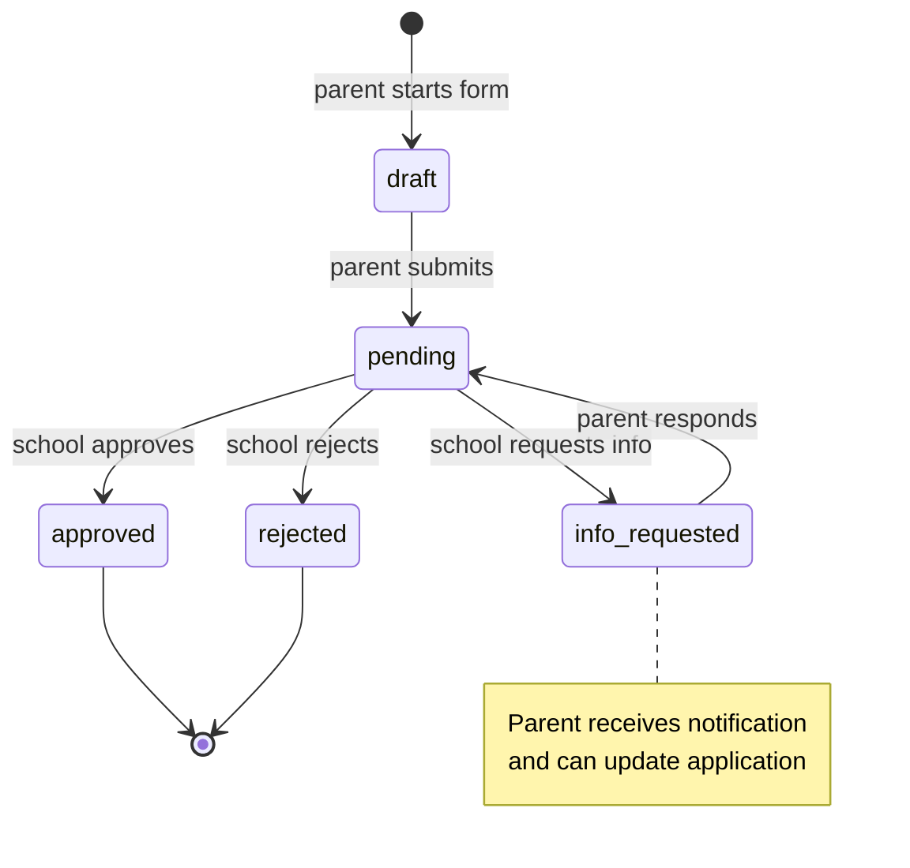

# VedaAcademy Enrolment Module — Product Requirements Document (PRD)

**Document Version:** 1.0
**Date:** October 2026
**Author:** Technology Consultant (on behalf of VedaAcademy)
**Status:** Draft — planning artifact
**Audience:** Development Team, QA, Product Owner, Designers
**Related:** [BUSINESS_REQUIREMENTS.md](BUSINESS_REQUIREMENTS.md), [Phase1_Architecture.md](Phase1_Architecture.md)

---

## Table of Contents

- [1. Introduction](#1-introduction)
  - [1.1 Product Vision](#11-product-vision)
  - [1.2 User Personas](#12-user-personas)
- [2. Feature Specifications](#2-feature-specifications)
  - [Feature 1: Parent Registration & Authentication](#feature-1-parent-registration--authentication)
  - [Feature 2: Parent Profile Management](#feature-2-parent-profile-management)
  - [Feature 3: Parent Dashboard](#feature-3-parent-dashboard)
  - [Feature 4: School Search & Discovery](#feature-4-school-search--discovery)
  - [Feature 5: Application Form (School-First)](#feature-5-application-form-school-first)
  - [Feature 6: School Onboarding](#feature-6-school-onboarding)
  - [Feature 7: School Staff Authentication](#feature-7-school-staff-authentication)
  - [Feature 8: Application Review & Actions](#feature-8-application-review--actions)
  - [Feature 9: Notification System](#feature-9-notification-system)
  - [Feature 10: Parent Follow-Up](#feature-10-parent-follow-up)
- [3. Non-Functional Requirements](#3-non-functional-requirements)
- [4. User Interface Requirements](#4-user-interface-requirements)
- [5. Error Handling & Edge Cases](#5-error-handling--edge-cases)
- [6. Acceptance Criteria Summary (Phase 1 Gate)](#6-acceptance-criteria-summary-phase-1-gate)

---

## 1. Introduction

This document defines the detailed product requirements, user stories, and acceptance criteria for **VedaAcademy Enrolment Module** — a standalone microservice enabling centralised school admissions through smartschooladmissions.com.

### 1.1 Product Vision

> "One application, many schools. VedaAcademy makes school admissions simple for parents and efficient for schools — no paper, no queues, no uncertainty."

### 1.2 User Personas

| Persona | Role | Goals | Pain Points |
|---------|------|-------|-------------|
| **Priya** | Parent (first-time applicant) | Find good schools for her child; apply with minimal effort; track application status | Visits multiple schools physically; fills repetitive forms; no status visibility |
| **Rajesh** | Parent (returning applicant) | Apply to new schools for second child; reuse profile | Has to re-enter personal details; loses track of previous applications |
| **Mrs. Sharma** | School Registrar | Review incoming applications efficiently; request missing documents; maintain records | Manages applications via email/spreadsheets; misses deadlines; no audit trail |
| **Mr. Kumar** | School Principal | See application pipeline at a glance; make admit/reject decisions | No dashboard; relies on registrar to compile reports manually |
| **Admin** | Platform Administrator | Onboard new schools; ensure platform quality; monitor usage | Manual school setup; no standardised onboarding flow |

---

## 2. Feature Specifications

---

### Feature 1: Parent Registration & Authentication

**Epic:** As a parent, I want to create an account and verify my identity so I can securely apply to schools.

**Sub-slice:** P1.1 (Week 1)

#### User Stories

| ID | Story | Priority |
|----|-------|----------|
| PA-01 | As a parent, I want to register with my email and password so I can create an account | P0 |
| PA-02 | As a parent, I want to verify my email address so my identity is confirmed | P0 |
| PA-03 | As a parent, I want to log in with my verified email so I can access my dashboard | P0 |
| PA-04 | As a parent, I want to reset my password if I forget it | P0 |
| PA-05 | As a parent arriving via a school's Apply Now link, I want to be redirected to register/login seamlessly | P0 |

#### Acceptance Criteria

- [ ] Registration requires email + password (min 8 chars, 1 uppercase, 1 number)
- [ ] Verification email sent within 30 seconds of registration
- [ ] Verification link expires after 24 hours
- [ ] Verified parents can log in and receive a JWT
- [ ] Unverified parents cannot access any portal functionality
- [ ] Password reset flow: email → token → new password
- [ ] Apply Now link preserves school_id in session; after login, parent is directed to that school's application
- [ ] Rate limit: 5 registration attempts per IP per hour

#### Error States

| Condition | Expected Behavior |
|-----------|-------------------|
| Duplicate email registration | 409 — "An account with this email already exists" |
| Invalid email format | 422 — validation error |
| Expired verification link | 410 — "Verification link expired. Request a new one." |
| Wrong password on login | 401 — "Invalid email or password" (no field-specific hint) |
| Unverified login attempt | 403 — "Please verify your email first" |

---

### Feature 2: Parent Profile Management

**Epic:** As a parent, I want to complete my profile with required information so I can proceed to apply.

**Sub-slice:** P1.2 (Week 2)

#### User Stories

| ID | Story | Priority |
|----|-------|----------|
| PP-01 | As a first-time parent, I must complete my profile before accessing the enrolment form | P0 |
| PP-02 | As a parent, I want to provide my full name, phone number, and address | P0 |
| PP-03 | As a parent, I want to upload my ID proof (Aadhaar, passport, driving licence) | P0 |
| PP-04 | As a parent, I want to update my profile information at any time | P1 |

#### Acceptance Criteria

- [ ] Incomplete profile → redirect to profile form on any navigation attempt
- [ ] Profile fields: full_name (required), phone (configurable required), address, id_proof_url (configurable required)
- [ ] ID proof upload: accepts PDF, JPG, PNG; max 5 MB
- [ ] ID proof stored in object storage with signed URL (1-hour expiry)
- [ ] Profile marked as complete when all mandatory fields are filled
- [ ] Profile editable after completion

#### Profile Form Fields

| Field | Type | Mandatory | Validation |
|-------|------|-----------|------------|
| `full_name` | text | Yes | 2–100 characters |
| `phone` | text | Configurable | E.164 format or Indian mobile (10 digits) |
| `address` | text | No | Max 500 characters |
| `city` | text | No | Max 100 characters |
| `state` | text | No | Max 100 characters |
| `id_proof_type` | select | Configurable | Aadhaar / Passport / Driving Licence / Voter ID |
| `id_proof_file` | file upload | Configurable | PDF/JPG/PNG, max 5 MB |

---

### Feature 3: Parent Dashboard

**Epic:** As a parent, I want a simple dashboard to see my applications and navigate the portal.

**Sub-slice:** P1.2 (Week 2)

#### User Stories

| ID | Story | Priority |
|----|-------|----------|
| PD-01 | As a parent, I want to see only three menu items: Dashboard, Enrolment, Profile | P0 |
| PD-02 | As a parent, I want to see a summary of my applications on the dashboard | P0 |
| PD-03 | As a parent, I want to see which applications need my attention (info requested) | P0 |

#### Acceptance Criteria

- [ ] Sidebar navigation: Dashboard, Enrolment, Profile — exactly 3 items
- [ ] Dashboard shows: total applications, pending, approved, rejected, info-requested counts
- [ ] Recent activity feed (last 5 events: submitted, status changed, info requested)
- [ ] "Action Required" badge on applications that need parent response
- [ ] Empty state: "No applications yet. Start your enrolment journey!" with CTA

---

### Feature 4: School Search & Discovery

**Epic:** As a parent, I want to search for schools by board or area so I can find the right school.

**Sub-slice:** P1.3 (Week 3)

#### User Stories

| ID | Story | Priority |
|----|-------|----------|
| SS-01 | As a parent, I want to search for schools by education board (CBSE, Matriculation, State Board) | P0 |
| SS-02 | As a parent, I want to search for schools by geographical area | P0 |
| SS-03 | As a parent, I want to search by school name | P0 |
| SS-04 | As a parent, I want to see school details (name, board, address, contact, status) | P0 |
| SS-05 | As a parent, I want to see clearly whether a school is active or inactive | P0 |
| SS-06 | As a parent, I want to compare schools side by side | P1 (Phase 2) |

#### Acceptance Criteria

- [ ] Search by board: dropdown with CBSE, ICSE, Matriculation, State Board, International Board, Other
- [ ] Search by area: free-text with autocomplete (city/locality)
- [ ] Search by name: free-text with partial match
- [ ] Combined filters (board + area + name)
- [ ] Results: paginated (20 per page), sortable by name/relevance
- [ ] School card: name, board, area, status badge (Active/Inactive/Accepting Applications)
- [ ] Active schools show "Apply" button; inactive schools show "Not Accepting Applications"
- [ ] School detail page: name, board, address, phone, email, description, facilities, application requirements
- [ ] Response time: < 300ms for search queries

---

### Feature 5: Application Form (School-First)

**Epic:** As a parent, I want to fill out and submit an application for my child to a selected school.

**Sub-slice:** P1.3 (Week 3)

#### User Stories

| ID | Story | Priority |
|----|-------|----------|
| AF-01 | As a parent, I want to start an application after selecting a school | P0 |
| AF-02 | As a parent, I want to fill in my child's details (name, DOB, gender, grade) | P0 |
| AF-03 | As a parent, I want to provide academic history (previous school, grades) | P0 |
| AF-04 | As a parent, I want to upload supporting documents (birth certificate, transcripts, photos) | P0 |
| AF-05 | As a parent, I want to save a draft and come back later | P1 |
| AF-06 | As a parent, I want to review my application before submitting | P0 |
| AF-07 | As a parent, I want to track my application status after submission | P0 |

#### Acceptance Criteria

- [ ] Profile must be complete before application form is accessible
- [ ] Application form is multi-step:
  - Step 1: Student Details (name, DOB, gender, nationality)
  - Step 2: Grade & Academic (grade applying for, previous school, marks, board)
  - Step 3: Additional Info (special needs, medical conditions, emergency contact)
  - Step 4: Documents (birth cert, transcripts, photo, additional docs)
  - Step 5: Review & Submit
- [ ] Draft auto-save every 30 seconds
- [ ] Explicit "Save Draft" button
- [ ] Review step shows all entered data with edit links per section
- [ ] Submit requires confirmation dialog
- [ ] After submission: status = "pending", application locked (no edits unless info requested)
- [ ] Application stored independently of Veda School database
- [ ] Document upload: 5 files max, 5 MB each, PDF/JPG/PNG

#### Application Form Schema

| Section | Field | Type | Required |
|---------|-------|------|----------|
| **Student Details** | student_full_name | text | Yes |
| | date_of_birth | date | Yes |
| | gender | select (Male/Female/Other) | Yes |
| | nationality | text | No |
| | religion | text | No |
| | mother_tongue | text | No |
| **Academic** | grade_applying_for | select | Yes |
| | previous_school_name | text | No |
| | previous_school_board | select | No |
| | previous_grade | text | No |
| | previous_marks_percentage | number | No |
| **Additional Info** | special_needs | text | No |
| | medical_conditions | text | No |
| | emergency_contact_name | text | Yes |
| | emergency_contact_phone | text | Yes |
| | relationship_to_student | select | Yes |
| **Documents** | birth_certificate | file | Yes |
| | recent_photo | file | Yes |
| | previous_transcripts | file | No |
| | additional_documents | file[] | No |

---

### Feature 6: School Onboarding

**Epic:** As a platform admin, I want to register a school so it can receive applications.

**Sub-slice:** P1.4 (Week 4)

#### User Stories

| ID | Story | Priority |
|----|-------|----------|
| SO-01 | As a platform admin, I want to register a new school with its details | P0 |
| SO-02 | As a platform admin, I want to add staff members to a school | P0 |
| SO-03 | As a platform admin, I want to generate a secure embed link for the school's website | P0 |
| SO-04 | As a school admin, I want to update my school's profile information | P1 |

#### Acceptance Criteria

- [ ] School registration: name, board, address, area, city, state, contact_email, phone, description
- [ ] School status: pending → active (after verification) → inactive (can be toggled)
- [ ] Staff creation: email, name, role (school_admin / reviewer / viewer)
- [ ] Staff receives email with setup link to create password
- [ ] Embed link: `https://smartschooladmissions.com/apply/{signed_token}`
- [ ] Signed token contains: school_id, issued_at, signature (HMAC-SHA256)
- [ ] Token does not expire (revokable by regenerating)
- [ ] Embed link resolves to application form with school pre-selected

---

### Feature 7: School Staff Authentication

**Epic:** As school staff, I want to log in securely to review applications submitted to my school.

**Sub-slice:** P1.4 (Week 4)

#### User Stories

| ID | Story | Priority |
|----|-------|----------|
| SA-01 | As school staff, I want to log in with credentials set during onboarding | P0 |
| SA-02 | As school staff, I want my access to be scoped to my school only | P0 |
| SA-03 | As school staff, I want to log out after reviewing applications | P0 |

#### Acceptance Criteria

- [ ] Staff login: email + password → JWT with school_id and role
- [ ] JWT.school_id enforced on all application queries (service layer, not just router)
- [ ] Roles: school_admin (manage settings + staff + all apps), reviewer (view + act on apps), viewer (read-only)
- [ ] Session timeout: 4 hours inactivity
- [ ] Logout: invalidate JWT (token blacklist in Redis)

---

### Feature 8: Application Review & Actions

**Epic:** As school staff, I want to review and act on applications submitted to my school.

**Sub-slice:** P1.4 (Week 4)

#### User Stories

| ID | Story | Priority |
|----|-------|----------|
| AR-01 | As a reviewer, I want to see all applications submitted to my school | P0 |
| AR-02 | As a reviewer, I want to view the full details of an application | P0 |
| AR-03 | As a reviewer, I want to approve an application | P0 |
| AR-04 | As a reviewer, I want to reject an application with a reason | P0 |
| AR-05 | As a reviewer, I want to request additional information or documents from the parent | P0 |
| AR-06 | As a school admin, I want to see who reviewed each application and when | P1 |

#### Acceptance Criteria

- [ ] Application list: filterable by status (all/pending/approved/rejected/info_requested), sortable by date
- [ ] Application detail: all student info, parent info, documents (viewable via signed URLs), status history
- [ ] Approve: one-click with optional notes → status changes to "approved"
- [ ] Reject: requires reason (text field, min 10 chars) → status changes to "rejected"
- [ ] Request Info: specify fields to update + documents to upload + message → status changes to "info_requested"
- [ ] All actions recorded in append-only `review_actions` table with performer and timestamp
- [ ] Staff can only act on applications where `application_schools.school_id = JWT.school_id`
- [ ] Viewer role: can see applications but action buttons are disabled/hidden

#### Application Status State Machine



---

### Feature 9: Notification System

**Epic:** As a user (parent or school staff), I want to receive email notifications for important events.

**Sub-slice:** P1.4 (Week 4)

#### User Stories

| ID | Story | Priority |
|----|-------|----------|
| NF-01 | As a school, I want to receive an email when a new application is submitted | P0 |
| NF-02 | As a parent, I want to receive an email when my application status changes | P0 |
| NF-03 | As a parent, I want to receive an email when a school requests additional information | P0 |
| NF-04 | As a school, I want the notification email to contain a secure link to the application | P0 |
| NF-05 | As a school, I want to receive a reminder if I haven't acted on an application in 7 days | P2 (Phase 2) |

#### Acceptance Criteria

- [ ] Email templates: `verify_email`, `app_received`, `app_approved`, `app_rejected`, `info_requested`, `info_provided`
- [ ] Secure links in emails: signed tokens that redirect to specific application
- [ ] Email sent within 60 seconds of triggering event
- [ ] Delivery logged in `notifications` table with status (sent/failed/bounced)
- [ ] HTML emails with responsive design; plain-text fallback
- [ ] Unsubscribe link in all non-transactional emails

#### Email Templates

| Template | Trigger | Recipient | Key Content |
|----------|---------|-----------|-------------|
| `verify_email` | Parent registers | Parent | Verification link (24h expiry) |
| `app_received` | Application submitted | School contact email | Student name, grade, [Review Application] button |
| `app_approved` | School approves | Parent | School name, "Congratulations" message |
| `app_rejected` | School rejects | Parent | School name, reason for rejection |
| `info_requested` | School requests info | Parent | School name, requested items list, [Update Application] button |
| `info_provided` | Parent responds | School contact email | Student name, [Review Updates] button |

---

### Feature 10: Parent Follow-Up

**Epic:** As a parent, I want to respond to information requests from schools.

**Sub-slice:** P1.4 (Week 4)

#### User Stories

| ID | Story | Priority |
|----|-------|----------|
| PF-01 | As a parent, I want to see which applications have pending info requests | P0 |
| PF-02 | As a parent, I want to update requested fields in my application | P0 |
| PF-03 | As a parent, I want to upload additional documents as requested | P0 |
| PF-04 | As a parent, I want the school to be notified when I respond | P0 |

#### Acceptance Criteria

- [ ] Dashboard highlights applications with "Action Required" status
- [ ] Info request shows: which fields to update, which documents to upload, school's message
- [ ] Parent can edit only the fields specified in the info request (not full form)
- [ ] Document upload for requested documents
- [ ] On response: status transitions from `info_requested` → `pending`
- [ ] Notification sent to school's contact email
- [ ] Response timestamp recorded; school sees when parent responded

---

## 3. Non-Functional Requirements

### 3.1 Performance

| Requirement | Target |
|-------------|--------|
| API response time (p50) | < 100ms |
| API response time (p95) | < 200ms |
| School search (p95) | < 300ms |
| Document upload (5 MB) | < 3s |
| Email delivery | < 60s from trigger |
| Concurrent parents | 200+ |
| Concurrent school staff | 50+ |

### 3.2 Security

| Requirement | Implementation |
|-------------|----------------|
| Authentication | bcrypt password hashing, JWT (RS256), email verification |
| Authorisation | RBAC: parent, school_admin, reviewer, viewer, platform_admin |
| Transport | HTTPS (TLS 1.3) on all endpoints |
| Data at rest | PostgreSQL encryption; R2 server-side encryption |
| Input validation | Pydantic strict mode on all request bodies |
| Rate limiting | Per-endpoint limits (auth: 5/15min, search: 60/min, submit: 10/hour) |
| File upload | MIME type validation, size limits, content scanning |
| OWASP Top 10 | SQL injection, XSS, CSRF, broken auth — all mitigated |

### 3.3 Scalability

| Requirement | Target |
|-------------|--------|
| Schools supported | 10,000+ |
| Applications per season | 100,000+ |
| Document storage | 1 TB+ (R2 free tier: 10 GB, then $0.015/GB) |
| Horizontal scaling | API stateless; add Fly.io machines as needed |

### 3.4 Reliability

| Requirement | Target |
|-------------|--------|
| Uptime | > 99.5% |
| Data backup | Daily automated PostgreSQL backup |
| Recovery time (RTO) | < 1 hour |
| Recovery point (RPO) | < 1 hour (daily backup + WAL) |

### 3.5 Compatibility

| Requirement | Target |
|-------------|--------|
| Browsers | Chrome 90+, Firefox 90+, Safari 15+, Edge 90+ |
| Mobile | Responsive design; mobile-first for parent portal |
| Screen sizes | 320px – 2560px |

---

## 4. User Interface Requirements

### 4.1 Navigation Structure

**Parent Portal:**
```
┌─────────────────────────────┐
│  VedaAcademy Logo           │
├─────────────────────────────┤
│  📊 Dashboard               │
│  📝 Enrolment               │
│  👤 Profile                 │
├─────────────────────────────┤
│  Logout                     │
└─────────────────────────────┘
```

**School Staff Portal:**
```
┌─────────────────────────────┐
│  School Logo + Name         │
├─────────────────────────────┤
│  📋 Applications            │
│  📊 Analytics (Phase 3)     │
│  ⚙️ Settings (admin only)   │
├─────────────────────────────┤
│  Logout                     │
└─────────────────────────────┘
```

### 4.2 Design System

| Element | Specification |
|---------|---------------|
| Primary colour | VedaAcademy brand (configurable) |
| Font | Inter (system fallback) |
| Component library | Tailwind CSS + shadcn/ui |
| Icons | Lucide React |
| Status badges | Green (approved), Red (rejected), Yellow (pending), Blue (info requested), Grey (draft) |

### 4.3 Responsive Breakpoints

| Breakpoint | Width | Target |
|------------|-------|--------|
| Mobile | 320px – 639px | Parent portal primary view |
| Tablet | 640px – 1023px | Parent + school staff |
| Desktop | 1024px+ | School staff primary view |

---

## 5. Error Handling & Edge Cases

| Scenario | Expected Behavior |
|----------|-------------------|
| Parent submits to inactive school | 403 — "This school is not currently accepting applications" |
| School staff accesses other school's app | 403 — "You do not have access to this application" |
| Parent submits duplicate application to same school | 409 — "You already have an application for this school" |
| Application form timeout (> 2 hours idle) | Auto-save draft; prompt to refresh session |
| Document upload fails mid-transfer | Retry with exponential backoff; show "Upload failed, please try again" |
| Email delivery fails | Log failure; retry 3 times with 1-min intervals; mark as failed after 3rd attempt |
| Parent deletes account with pending applications | Soft-delete parent; applications remain visible to schools with "Parent account deactivated" note |
| School deactivated with pending applications | Applications remain; school staff notified; parents notified of school status change |
| Concurrent review by two staff members | Optimistic locking; second action fails with "Application status has changed" |

---

## 6. Acceptance Criteria Summary (Phase 1 Gate)

### Functional Gates

- [ ] Parent can register, verify email, log in
- [ ] Parent can complete profile with mandatory fields
- [ ] Parent can search schools by board and area
- [ ] Parent can view school details
- [ ] Parent can fill and submit application to a single school
- [ ] Parent can upload documents with application
- [ ] Parent can track application status
- [ ] School can be onboarded with staff accounts
- [ ] School staff can log in and see their school's applications only
- [ ] School staff can approve, reject, or request additional information
- [ ] Parent can respond to info requests
- [ ] Email notifications sent for all lifecycle events
- [ ] Embed link works: school website → portal → application

### Security Gates

- [ ] Separate auth for parents and school staff
- [ ] RBAC enforced: viewer/reviewer/school_admin roles
- [ ] School-scoped queries enforced at service layer
- [ ] Rate limiting on auth and submission endpoints
- [ ] HTTPS on all endpoints
- [ ] Document uploads validated (type + size)

### Performance Gates

- [ ] p95 API latency < 200ms (measured with load)
- [ ] School search < 300ms with 1,000 schools
- [ ] Document upload < 3s for 5 MB file
- [ ] 200 concurrent parent sessions without degradation

---

**Last Updated:** October 24, 2026
**Version:** 1.0
**Status:** Draft — planning artifact
