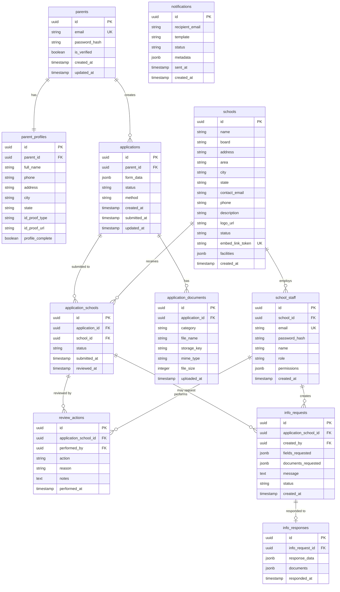
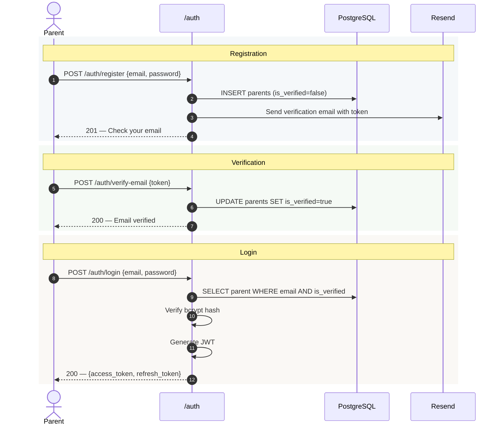
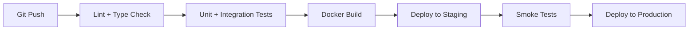

# VedaAcademy Enrolment Module — Phase 1 Architecture Design Document

**Document Version:** 1.0
**Date:** October 2026
**Status:** Architecture Blueprint
**Audience:** Development Team, DevOps, CTO
**Related:** [BUSINESS_REQUIREMENTS.md](BUSINESS_REQUIREMENTS.md), [PRODUCT_REQUIREMENTS.md](PRODUCT_REQUIREMENTS.md), [../ARCHITECTURE_AND_FLOWS.md](../ARCHITECTURE_AND_FLOWS.md)

---

## Table of Contents

- [1. Architecture Overview](#1-architecture-overview)
- [2. Technology Stack](#2-technology-stack)
- [3. System Architecture](#3-system-architecture)
- [4. Service Architecture](#4-service-architecture)
- [5. Database Design](#5-database-design)
- [6. Authentication & Authorisation](#6-authentication--authorisation)
- [7. Security Architecture](#7-security-architecture)
- [8. Deployment Architecture](#8-deployment-architecture)
- [9. Integration Points](#9-integration-points)
- [10. Data Flow Diagrams](#10-data-flow-diagrams)
- [11. Scalability & Performance](#11-scalability--performance)
- [12. Implementation Roadmap](#12-implementation-roadmap)
- [13. Design Decisions Open for Phase 2](#13-design-decisions-open-for-phase-2)

---

## 1. Architecture Overview

### 1.1 High-Level Architecture

VedaAcademy Enrolment is a **standalone microservice** deployed independently from Veda School with the following characteristics:

- **Single FastAPI application** serving both parent and school staff APIs
- **Separate authentication** for parents (email-verified) and school staff (credentials-based)
- **PostgreSQL database** (Neon) with dedicated schema — no shared tables with Veda School
- **Object storage** (Cloudflare R2) for documents, ID proofs, and school media
- **Email service** (Resend) for transactional notifications
- **Redis** (Upstash) for session management, rate limiting, and caching
- **React SPA** for both parent portal and school staff portal

### 1.2 Design Principles

1. **Standalone first:** Enrolment has its own database, auth, and deployment — zero coupling to Veda School
2. **No tenant per parent:** Parents are portal users, not tenants; no org creation overhead
3. **School-scoped isolation:** School staff see only their school's applications; enforced at service layer
4. **Stateless API:** All state in PostgreSQL and Redis; API horizontally scalable
5. **Email as primary channel:** All notifications via email in Phase 1; push/SMS deferred
6. **Progressive enhancement:** Phase 1 = school-first manual flow; Phase 2 adds agentic AI

---

## 2. Technology Stack

### 2.1 Languages & Frameworks

| Layer | Technology | Version | Notes |
|-------|-----------|---------|-------|
| **Backend API** | Python + FastAPI | 3.11+ | Async-first REST API |
| **Frontend** | React + TypeScript | 18+ | SPA; parent + staff portals |
| **Database** | PostgreSQL (Neon) | 16+ | Managed serverless PostgreSQL |
| **Cache** | Redis (Upstash) | 7+ | Sessions, rate limiting, search cache |
| **Object Storage** | Cloudflare R2 | N/A | S3-compatible; documents, ID proofs |
| **Email** | Resend | N/A | Transactional email delivery |
| **Container** | Docker | 24+ | Local dev + production images |
| **CI/CD** | GitHub Actions | N/A | Lint, test, build, deploy |

### 2.2 Backend Dependencies

| Package | Purpose |
|---------|---------|
| `fastapi` | HTTP framework |
| `uvicorn` | ASGI server |
| `sqlalchemy` + `asyncpg` | Database ORM + async driver |
| `alembic` | Database migrations |
| `pydantic` | Request/response validation |
| `python-jose` | JWT creation and validation |
| `passlib[bcrypt]` | Password hashing |
| `boto3` | S3/R2 object storage client |
| `resend` | Email delivery |
| `redis` | Cache + rate limiting |
| `httpx` | Async HTTP client (internal calls) |

### 2.3 Frontend Dependencies

| Package | Purpose |
|---------|---------|
| `react` + `react-dom` | UI framework |
| `@tanstack/react-query` | Server state management |
| `react-router-dom` | Client-side routing |
| `tailwindcss` | Utility-first CSS |
| `shadcn/ui` | Component library |
| `lucide-react` | Icons |
| `react-hook-form` + `zod` | Form management + validation |
| `axios` | HTTP client |

---

## 3. System Architecture

### 3.1 Deployment Diagram

```
                    Internet
                       │
                       ▼
              ┌─────────────────┐
              │   Cloudflare    │
              │   (CDN + DNS)   │
              │ smartschooladm  │
              │ issions.com     │
              └────────┬────────┘
                       │
            ┌──────────┴──────────┐
            ▼                      ▼
   ┌─────────────────┐   ┌─────────────────┐
   │  Frontend SPA    │   │  API Service     │
   │  (React)         │   │  (FastAPI)       │
   │  Fly.io static   │   │  Fly.io machine  │
   │  Port: 3000      │   │  Port: 8000      │
   └─────────────────┘   └────────┬─────────┘
                                   │
                    ┌──────────────┼──────────────┐
                    ▼              ▼              ▼
           ┌──────────────┐ ┌──────────┐ ┌──────────────┐
           │ PostgreSQL    │ │ Redis    │ │ R2 Storage   │
           │ (Neon)        │ │(Upstash) │ │ (Cloudflare) │
           │               │ │          │ │              │
           │ enrolment_db  │ │Sessions  │ │Documents     │
           └──────────────┘ │Cache     │ │ID proofs     │
                            │Rate lim  │ └──────────────┘
                            └──────────┘
```

### 3.2 Local Development

```bash
# docker-compose.yml services
services:
  enrolment-api:     # FastAPI on port 8000
  enrolment-web:     # React dev server on port 3000
  enrolment-db:      # PostgreSQL 16 on port 5433
  enrolment-redis:   # Redis 7 on port 6380
  enrolment-minio:   # MinIO (S3-compatible) on port 9000
  enrolment-mailpit: # Email testing on port 8025
```

---

## 4. Service Architecture

### 4.1 API Application Structure

```
services/enrolment-api/
├── app/
│   ├── main.py                    # FastAPI app factory
│   ├── config.py                  # Settings (env vars)
│   ├── deps.py                    # Dependency injection (db, redis, storage)
│   │
│   ├── routers/                   # HTTP route handlers
│   │   ├── auth.py                # /auth/* — parent registration, login, verify
│   │   ├── auth_staff.py          # /auth/staff/* — school staff login
│   │   ├── parents.py             # /parents/* — profile, dashboard
│   │   ├── schools.py             # /schools/* — search, detail, onboard
│   │   ├── applications.py        # /applications/* — CRUD, submit, documents
│   │   ├── staff_applications.py  # /staff/applications/* — review, actions
│   │   ├── chatbot.py             # /chatbot/* — agentic flow (Phase 2)
│   │   └── analytics.py           # /analytics/* — dashboards (Phase 3)
│   │
│   ├── services/                  # Business logic
│   │   ├── auth_service.py
│   │   ├── profile_service.py
│   │   ├── school_service.py
│   │   ├── application_service.py
│   │   ├── review_service.py
│   │   ├── notification_service.py
│   │   ├── document_service.py
│   │   └── chatbot_service.py     # Phase 2
│   │
│   ├── models/                    # SQLAlchemy models
│   │   ├── parent.py
│   │   ├── parent_profile.py
│   │   ├── school.py
│   │   ├── school_staff.py
│   │   ├── application.py
│   │   ├── application_school.py
│   │   ├── application_document.py
│   │   ├── review_action.py
│   │   ├── info_request.py
│   │   ├── info_response.py
│   │   └── notification.py
│   │
│   ├── schemas/                   # Pydantic request/response schemas
│   │   ├── auth.py
│   │   ├── parent.py
│   │   ├── school.py
│   │   ├── application.py
│   │   └── review.py
│   │
│   ├── middleware/                 # Middleware
│   │   ├── auth_middleware.py     # JWT validation
│   │   ├── profile_gate.py       # Profile completion check
│   │   ├── rate_limiter.py       # Rate limiting
│   │   └── school_scope.py       # School-scoped query enforcement
│   │
│   └── utils/
│       ├── email_templates.py     # Email template rendering
│       ├── signed_urls.py         # Signed URL generation (R2, embed links)
│       └── tokens.py              # JWT + verification token utilities
│
├── migrations/                    # Alembic migrations
├── tests/                         # Test suite
├── Dockerfile
└── pyproject.toml
```

### 4.2 Frontend Application Structure

```
services/enrolment-web/
├── src/
│   ├── App.tsx
│   ├── main.tsx
│   │
│   ├── pages/
│   │   ├── auth/
│   │   │   ├── LoginPage.tsx
│   │   │   ├── RegisterPage.tsx
│   │   │   └── VerifyEmailPage.tsx
│   │   ├── parent/
│   │   │   ├── DashboardPage.tsx
│   │   │   ├── ProfilePage.tsx
│   │   │   ├── SchoolSearchPage.tsx
│   │   │   ├── SchoolDetailPage.tsx
│   │   │   ├── ApplicationFormPage.tsx
│   │   │   ├── ApplicationListPage.tsx
│   │   │   └── ApplicationDetailPage.tsx
│   │   ├── staff/
│   │   │   ├── StaffLoginPage.tsx
│   │   │   ├── ApplicationListPage.tsx
│   │   │   ├── ApplicationReviewPage.tsx
│   │   │   └── AnalyticsPage.tsx        # Phase 3
│   │   └── chatbot/
│   │       └── ChatbotPage.tsx           # Phase 2
│   │
│   ├── components/
│   │   ├── layout/
│   │   │   ├── ParentLayout.tsx
│   │   │   ├── StaffLayout.tsx
│   │   │   └── Sidebar.tsx
│   │   ├── forms/
│   │   │   ├── ApplicationForm.tsx
│   │   │   ├── ProfileForm.tsx
│   │   │   └── DocumentUpload.tsx
│   │   └── ui/                          # shadcn/ui components
│   │
│   ├── hooks/
│   │   ├── useAuth.ts
│   │   ├── useProfile.ts
│   │   ├── useApplications.ts
│   │   └── useSchools.ts
│   │
│   ├── api/
│   │   ├── client.ts                    # Axios instance with JWT interceptor
│   │   ├── auth.ts
│   │   ├── parents.ts
│   │   ├── schools.ts
│   │   └── applications.ts
│   │
│   └── lib/
│       ├── auth.ts                      # JWT storage + refresh
│       └── utils.ts
│
├── Dockerfile
├── tailwind.config.ts
└── package.json
```

---

## 5. Database Design

### 5.1 Entity-Relationship Overview



### 5.2 Key Indexes

| Table | Index | Columns | Purpose |
|-------|-------|---------|---------|
| `parents` | `ix_parents_email` | email | Login lookup |
| `schools` | `ix_schools_board` | board | Board filter |
| `schools` | `ix_schools_area` | area | Area filter |
| `schools` | `ix_schools_status` | status | Active/inactive filter |
| `schools` | `ix_schools_embed_token` | embed_link_token | Embed link resolve |
| `applications` | `ix_applications_parent_id` | parent_id | Parent's applications |
| `application_schools` | `ix_app_schools_school_id` | school_id | School's applications |
| `application_schools` | `ix_app_schools_status` | status | Status filter |
| `application_schools` | `uq_app_schools_app_school` | application_id, school_id | Prevent duplicate submissions |
| `review_actions` | `ix_review_actions_app_school` | application_school_id | Review history |

### 5.3 Key Constraints

- `parents.email` — UNIQUE
- `school_staff.email` — UNIQUE
- `schools.embed_link_token` — UNIQUE
- `application_schools(application_id, school_id)` — UNIQUE (prevent duplicate submission)
- `parent_profiles.parent_id` — FK → parents.id, UNIQUE (1:1)
- `school_staff.school_id` — FK → schools.id
- `applications.parent_id` — FK → parents.id
- `review_actions` — append-only (no UPDATE or DELETE operations)

---

## 6. Authentication & Authorisation

### 6.1 JWT Structure

**Parent JWT:**
```json
{
  "sub": "parent_uuid",
  "role": "parent",
  "email": "parent@email.com",
  "profile_complete": true,
  "iat": 1698134400,
  "exp": 1698220800
}
```

**School Staff JWT:**
```json
{
  "sub": "staff_uuid",
  "role": "school_admin",
  "school_id": "school_uuid",
  "permissions": ["applications:read", "applications:review", "school:manage"],
  "iat": 1698134400,
  "exp": 1698220800
}
```

### 6.2 Permission Matrix

| Permission | school_admin | reviewer | viewer | parent |
|------------|:------------:|:--------:|:------:|:------:|
| `applications:read` | Yes | Yes | Yes | Own only |
| `applications:review` | Yes | Yes | No | No |
| `applications:manage` | Yes | No | No | No |
| `school:manage` | Yes | No | No | No |
| `school:staff_manage` | Yes | No | No | No |
| `profile:manage` | No | No | No | Yes |
| `applications:create` | No | No | No | Yes |
| `documents:upload` | No | No | No | Yes |

### 6.3 Auth Flow Diagrams



---

## 7. Security Architecture

### 7.1 Threat Model

| Threat | Mitigation |
|--------|------------|
| Credential stuffing | Rate limit: 5 login attempts per 15 min per IP |
| JWT theft | Short expiry (24h), refresh token rotation, HTTPS-only |
| Cross-school data access | school_id from JWT, enforced at service layer |
| Document exfiltration | Signed URLs with 1-hour expiry |
| SQL injection | SQLAlchemy ORM; parameterised queries only |
| XSS | React escapes by default; CSP headers |
| CSRF | SameSite cookies; token-based CSRF |
| File upload abuse | MIME validation, size limits, malware scanning (Phase 3) |

### 7.2 Rate Limiting

| Endpoint Group | Limit |
|----------------|-------|
| `/auth/register` | 5 per IP per hour |
| `/auth/login` | 5 per IP per 15 min |
| `/auth/verify-email` | 10 per IP per hour |
| `/schools/search` | 60 per user per min |
| `/applications` (POST) | 10 per user per hour |
| `/applications/*/documents` | 20 per user per hour |
| All other endpoints | 120 per user per min |

---

## 8. Deployment Architecture

### 8.1 Production Infrastructure

| Service | Provider | Tier | Monthly Cost |
|---------|----------|------|-------------|
| **API Server** | Fly.io | shared-cpu-1x, 256 MB | $0 (free allowance) |
| **Frontend** | Fly.io | static site | $0 (free allowance) |
| **PostgreSQL** | Neon | Free tier (0.5 GB) | $0 |
| **Redis** | Upstash | Free tier (10K cmd/day) | $0 |
| **Object Storage** | Cloudflare R2 | Free tier (10 GB) | $0 |
| **Email** | Resend | Free tier (100 emails/day) | $0 |
| **DNS + CDN** | Cloudflare | Free tier | $0 |
| **Total** | | | **$0/month** (free tier) |

### 8.2 CI/CD Pipeline



---

## 9. Integration Points

### 9.1 External Services

| Service | Integration | Protocol | Phase |
|---------|-------------|----------|-------|
| Resend | Email delivery | REST API | P1.1 |
| Cloudflare R2 | Document storage | S3 API (boto3) | P1.1 |
| Upstash Redis | Session + cache | Redis protocol | P1.1 |
| Neon PostgreSQL | Primary database | PostgreSQL wire | P1.1 |
| LiteLLM | Chatbot AI | REST API | P2.1 |

### 9.2 Veda School Integration (Future)

| Integration | Direction | Method | Phase |
|-------------|-----------|--------|-------|
| School registry sync | Veda School → Enrolment | Webhook / API pull | Phase 4+ |
| Admitted student sync | Enrolment → Veda School SIS | API push | Phase 4+ |
| Authentication SSO | Shared auth service | OAuth2 | Phase 4+ |

---

## 10. Data Flow Diagrams

See [../ARCHITECTURE_AND_FLOWS.md](../ARCHITECTURE_AND_FLOWS.md) for complete ASCII data flow diagrams covering:
- School-First application flow
- Application-First (Agentic) flow
- School review flow
- Notification pipeline
- School onboarding flow

See [../diagrams/](../diagrams/) for Mermaid sequence diagrams.

---

## 11. Scalability & Performance

### 11.1 Performance Targets

| Metric | Target | Measurement |
|--------|--------|-------------|
| API p50 latency | < 100ms | All endpoints |
| API p95 latency | < 200ms | All endpoints |
| School search p95 | < 300ms | With 1,000+ schools |
| Document upload p95 | < 3s | 5 MB file |
| Concurrent parents | 200+ | Without degradation |
| Concurrent staff | 50+ | Without degradation |

### 11.2 Scaling Strategy

| Component | Strategy |
|-----------|----------|
| API | Stateless; scale horizontally with Fly.io machines |
| Database | Neon auto-scaling; read replicas if needed |
| Redis | Upstash serverless; scales automatically |
| Storage | R2 unlimited; no scaling concern |
| Email | Resend scales with plan upgrade |
| Frontend | CDN-served static files; no scaling concern |

---

## 12. Implementation Roadmap

### Phase 1a — Infrastructure + Auth (Week 1)

| Task | Effort | Dependencies |
|------|--------|--------------|
| PostgreSQL schema + Alembic setup | 1 day | None |
| FastAPI skeleton + project structure | 0.5 day | None |
| Docker Compose for local dev | 0.5 day | None |
| Parent registration + email verification | 1 day | Schema |
| Parent login + JWT | 0.5 day | Registration |
| School staff login + JWT | 0.5 day | Schema |
| Rate limiter middleware | 0.5 day | Redis |
| R2 storage client | 0.5 day | None |
| Resend email integration | 0.5 day | None |
| CI pipeline (lint + test) | 0.5 day | None |

### Phase 1b — Parent Portal (Week 2)

| Task | Effort | Dependencies |
|------|--------|--------------|
| Profile CRUD endpoints | 1 day | Auth |
| Profile completion gate middleware | 0.5 day | Profile |
| ID proof upload (R2 + signed URL) | 0.5 day | R2 client |
| Dashboard summary endpoint | 0.5 day | Auth |
| Frontend: Login + Register pages | 1 day | Auth API |
| Frontend: Profile form + upload | 1 day | Profile API |
| Frontend: Dashboard + navigation | 0.5 day | Dashboard API |
| Frontend: Parent layout (3 menu items) | 0.5 day | None |

### Phase 1c — School-First Application (Week 3)

| Task | Effort | Dependencies |
|------|--------|--------------|
| School search + filter endpoints | 1 day | Schema |
| School detail endpoint | 0.5 day | Schema |
| Application CRUD endpoints | 1 day | Auth |
| Document upload endpoints | 0.5 day | R2 |
| Application submit + status transitions | 0.5 day | Application |
| Frontend: School search page | 1 day | Search API |
| Frontend: School detail page | 0.5 day | Detail API |
| Frontend: Multi-step application form | 1.5 days | Application API |
| Frontend: Document upload component | 0.5 day | Upload API |

### Phase 1d — School Review + Notifications (Week 4)

| Task | Effort | Dependencies |
|------|--------|--------------|
| School onboarding endpoints | 1 day | Schema |
| Embed link generation (signed tokens) | 0.5 day | School |
| Staff application list (school-scoped) | 0.5 day | Auth |
| Approve / reject / request-info actions | 1 day | Applications |
| Review history (append-only) | 0.5 day | Review actions |
| Parent follow-up (respond to info request) | 0.5 day | Info requests |
| Email notification templates (6 templates) | 1 day | Resend |
| Frontend: Staff login + application list | 1 day | Staff API |
| Frontend: Application review + action buttons | 1 day | Review API |
| Frontend: Info request dialog | 0.5 day | Info request API |
| Integration test: E2E parent→school flow | 0.5 day | All |

---

## 13. Design Decisions Open for Phase 2

| # | Decision | Options | Recommendation |
|---|----------|---------|----------------|
| 1 | LLM provider for agentic chatbot | LiteLLM (multi-provider) vs direct OpenAI | LiteLLM — consistent with Veda platform |
| 2 | Chatbot state management | Redis session vs database | Database — conversation history is valuable |
| 3 | Multi-school eligibility rules | School-defined vs platform-defined | School-defined — each school sets their criteria |
| 4 | School comparison data source | School self-reported vs aggregated | Self-reported in Phase 2; enriched in Phase 3 |
| 5 | Payment for application fees | Stripe vs Razorpay | Razorpay for India market; Stripe for international |
| 6 | Veda School data sync mechanism | Webhooks vs polling vs event bus | Event bus (future); API polling in Phase 4 |
| 7 | Document storage long-term | R2 vs dedicated document service | R2 for Phase 1–2; evaluate in Phase 3 |

---

**Last Updated:** October 24, 2026
**Version:** 1.0
**Status:** Architecture Blueprint
