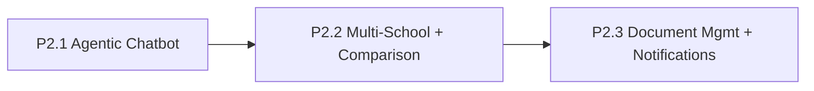
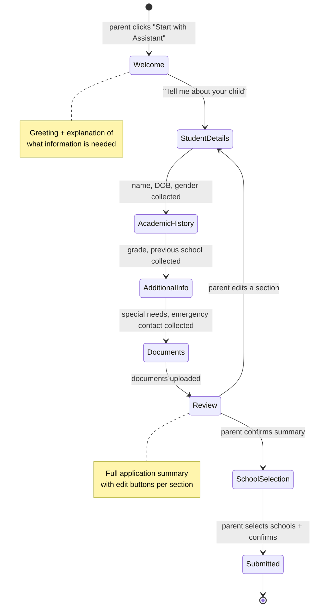
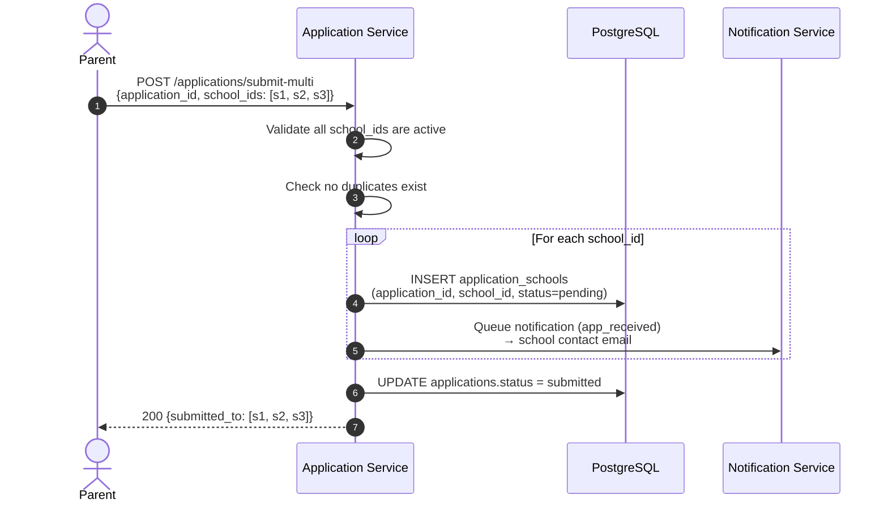
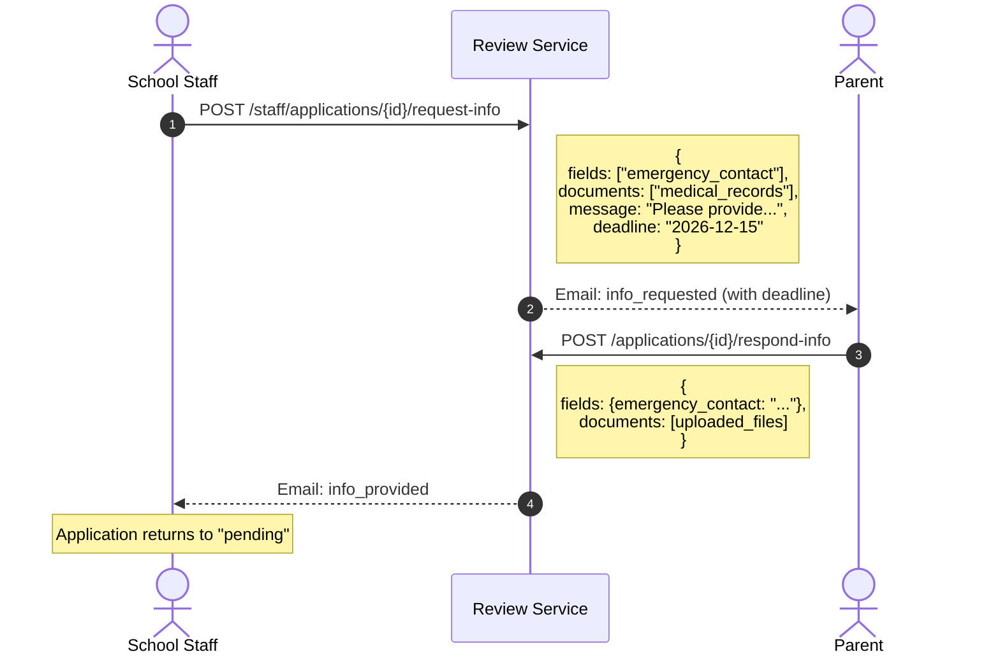

# VedaAcademy Enrolment — Phase 2: Agentic & Advanced Features

**Document Version:** 1.0
**Date:** October 2026
**Status:** Draft — planning artifact
**Audience:** Development team, AI engineers, product managers
**Related:** [../Phase1/PRODUCT_REQUIREMENTS.md](../Phase1/PRODUCT_REQUIREMENTS.md), [../ARCHITECTURE_AND_FLOWS.md](../ARCHITECTURE_AND_FLOWS.md)

---

## Table of Contents

1. [Overview](#1-overview)
2. [P2.1 — Agentic chatbot application flow](#2-p21--agentic-chatbot-application-flow)
3. [P2.2 — Multi-school submission and comparison](#3-p22--multi-school-submission-and-comparison)
4. [P2.3 — Advanced document management and notifications](#4-p23--advanced-document-management-and-notifications)
5. [Technical architecture additions](#5-technical-architecture-additions)
6. [Acceptance criteria (Phase 2 gate)](#6-acceptance-criteria-phase-2-gate)

---

## 1. Overview

Phase 2 transforms the enrolment platform from a form-based tool into an AI-assisted, multi-school admissions platform. The three sub-slices are ordered by dependency:



**Phase 2 does not change Phase 1 flows.** Parents who prefer the school-first manual approach continue to use it. The agentic path is an alternative, not a replacement.

---

## 2. P2.1 — Agentic chatbot application flow

**Duration:** Week 5
**Depends on:** Phase 1 complete (parent portal, application schema stable)

### 2.1 Concept

Instead of filling a multi-step form, the parent converses with an AI chatbot that collects application information through natural dialogue, validates responses, and produces a structured application for review before submission.

### 2.2 User stories

| ID | Story | Priority |
|----|-------|----------|
| CB-01 | As a parent, I want to complete my application through a guided conversation | P0 |
| CB-02 | As a parent, I want the chatbot to ask me one topic at a time | P0 |
| CB-03 | As a parent, I want to review the completed application summary before submitting | P0 |
| CB-04 | As a parent, I want to edit specific fields in the summary before final submission | P1 |
| CB-05 | As a parent, I want to switch to the manual form if the chatbot is not helpful | P0 |
| CB-06 | As a parent, I want the chatbot to remember what I've already provided | P0 |

### 2.3 Conversation flow



### 2.4 Conversation state machine

| State | Chatbot Action | Data Collected | Validation |
|-------|---------------|----------------|------------|
| `welcome` | Greet parent; explain process | None | N/A |
| `student_details` | Ask child's name, DOB, gender, nationality | student_full_name, date_of_birth, gender | Name 2–100 chars; DOB valid date; gender in enum |
| `academic_history` | Ask grade, previous school, board, marks | grade_applying_for, previous_school_name, board, marks | Grade in valid range |
| `additional_info` | Ask special needs, medical, emergency contact | special_needs, medical, emergency_contact | Emergency contact phone valid |
| `documents` | Ask to upload required documents | birth_cert, photo, transcripts | File type + size validation |
| `review` | Show structured summary; ask to confirm or edit | None (display only) | All required fields present |
| `school_selection` | Show eligible schools; let parent select | selected_school_ids | At least one active school selected |
| `submitted` | Confirm submission; show next steps | None | N/A |

### 2.5 AI integration

| Component | Technology | Purpose |
|-----------|-----------|---------|
| LLM | LiteLLM (GPT-4o or Claude) | Generate conversational prompts; extract structured data from natural language |
| Prompt template | System prompt + conversation history | Guide the LLM to ask one topic at a time; validate responses |
| Extraction | Structured output / function calling | Map natural language to application schema fields |
| Fallback | Manual form pre-populated | If chatbot cannot extract valid data after 3 retries, switch to form |

### 2.6 Technical design

```
┌───────────────────────────────────────────────────────────────┐
│  CHATBOT SERVICE ARCHITECTURE                                  │
│                                                                │
│  Frontend (ChatbotPage.tsx)                                    │
│  ┌──────────────────────────────────────────────────────────┐ │
│  │ Chat UI: message bubbles, typing indicator, file upload  │ │
│  │ POST /chatbot/start → session_id                         │ │
│  │ POST /chatbot/respond → {response, next_question, state} │ │
│  │ GET /chatbot/summary → {application_data, completeness}  │ │
│  └──────────────────────────────────────────────────────────┘ │
│                          │                                     │
│                          ▼                                     │
│  Chatbot Service (chatbot_service.py)                         │
│  ┌──────────────────────────────────────────────────────────┐ │
│  │ start_conversation() → create session, return welcome     │ │
│  │ process_response()                                        │ │
│  │   1. Load session state from DB                           │ │
│  │   2. Append user message to history                       │ │
│  │   3. Call LLM with system prompt + history                │ │
│  │   4. Extract structured fields from LLM response          │ │
│  │   5. Validate extracted fields                            │ │
│  │   6. Advance state if current topic complete              │ │
│  │   7. Save updated session                                 │ │
│  │   8. Return next question + updated state                 │ │
│  │ generate_summary() → map conversation to app schema       │ │
│  │ map_to_application() → create Application from session    │ │
│  └──────────────────────────────────────────────────────────┘ │
│                          │                                     │
│                          ▼                                     │
│  ┌──────────────┐ ┌──────────────┐ ┌──────────────────────┐  │
│  │ chatbot_     │ │ LiteLLM      │ │ application_service  │  │
│  │ sessions DB  │ │ (GPT-4o)     │ │ .create_application()│  │
│  └──────────────┘ └──────────────┘ └──────────────────────┘  │
└───────────────────────────────────────────────────────────────┘
```

### 2.7 Database additions

| Table | New Fields | Purpose |
|-------|-----------|---------|
| `chatbot_sessions` (new) | id, parent_id, conversation_state (JSONB), conversation_history (JSONB), application_data (JSONB), current_topic, status, created_at, updated_at | Persist conversation state between requests |

---

## 3. P2.2 — Multi-school submission and comparison

**Duration:** Week 6
**Depends on:** P2.1 (agentic flow produces valid application data)

### 3.1 School comparison

| ID | Story | Priority |
|----|-------|----------|
| MC-01 | As a parent, I want to compare 2–4 schools side by side | P0 |
| MC-02 | As a parent, I want to see school facilities, board, fees range, location on a comparison table | P0 |
| MC-03 | As a parent, I want to add/remove schools from comparison | P1 |

#### Comparison fields

| Field | Source | Notes |
|-------|--------|-------|
| School name | `schools.name` | Always shown |
| Education board | `schools.board` | Always shown |
| Location | `schools.area`, `schools.city` | Always shown |
| Status | `schools.status` | Active / Inactive badge |
| Facilities | `schools.facilities` (JSONB) | Labs, library, sports, transport, etc. |
| Fee range | `schools.fee_range` (new) | "₹50K – ₹80K / year" or "Contact school" |
| Student-teacher ratio | `schools.student_teacher_ratio` (new) | Optional; shown if available |
| Grades offered | `schools.grades_offered` (new JSONB) | Array of grade ranges |

#### API

- `GET /api/v1/schools/compare?ids=uuid1,uuid2,uuid3` — returns comparison data for up to 4 schools

### 3.2 Multi-school submission

| ID | Story | Priority |
|----|-------|----------|
| MS-01 | As a parent using the agentic flow, I want to select multiple schools from the eligible list | P0 |
| MS-02 | As a parent, I want to see both active and inactive schools with clear status labels | P0 |
| MS-03 | As a parent, I want to submit my single application to all selected active schools | P0 |
| MS-04 | As a parent, I want to track per-school status independently | P0 |

#### Eligibility rules

| Rule | Behavior |
|------|----------|
| School status = `active` | Selectable for submission |
| School status = `inactive` | Shown but greyed out with "Not Accepting Applications" |
| School status = `pending` | Not shown to parents |
| Parent already applied to school | Shown with "Already Applied" badge; not selectable |
| School grade range doesn't match | Shown with "Grade not available" warning |

#### Submission flow



### 3.3 Schema additions

| Table | New Columns | Purpose |
|-------|-------------|---------|
| `schools` | `fee_range` (text), `student_teacher_ratio` (text), `grades_offered` (JSONB) | Comparison data |

---

## 4. P2.3 — Advanced document management and notifications

**Duration:** Week 7
**Depends on:** P1.4 (info request flow), P2.2 (multi-school)

### 4.1 Document categories and management

| Category | Required | Max Files | Max Size | Accepted Types |
|----------|----------|-----------|----------|----------------|
| Birth certificate | Yes | 1 | 5 MB | PDF, JPG, PNG |
| Recent photo | Yes | 1 | 2 MB | JPG, PNG |
| Previous transcripts | No | 5 | 5 MB each | PDF |
| Medical records | No | 3 | 5 MB each | PDF |
| ID proof (parent) | Configurable | 1 | 5 MB | PDF, JPG, PNG |
| Additional | No | 10 | 5 MB each | PDF, JPG, PNG |

### 4.2 Enhanced request-info workflow



**New:** Info requests now include an optional `deadline` field. Automated reminder emails are sent 2 days before the deadline if the parent has not responded.

### 4.3 Advanced notification system

| Template | Trigger | New in Phase 2 |
|----------|---------|-----------------|
| `app_reminder` | 7 days since submission, no school action | Yes |
| `info_deadline_reminder` | 2 days before info request deadline | Yes |
| `multi_school_summary` | After multi-school submission | Yes |
| `weekly_digest` | Weekly summary of all application statuses | Yes |

#### Notification preferences

| Setting | Options | Default |
|---------|---------|---------|
| Notification frequency | Immediate / Daily digest / Weekly digest | Immediate |
| Reminder emails | On / Off | On |
| Application status updates | On / Off | On |

---

## 5. Technical architecture additions

### 5.1 New API endpoints

| Method | Endpoint | Phase |
|--------|----------|-------|
| POST | `/api/v1/chatbot/start` | P2.1 |
| POST | `/api/v1/chatbot/respond` | P2.1 |
| GET | `/api/v1/chatbot/summary` | P2.1 |
| POST | `/api/v1/chatbot/switch-to-form` | P2.1 |
| GET | `/api/v1/schools/compare` | P2.2 |
| GET | `/api/v1/schools/eligible` | P2.2 |
| POST | `/api/v1/applications/submit-multi` | P2.2 |
| PUT | `/api/v1/parents/notification-preferences` | P2.3 |

### 5.2 New database tables

```sql
CREATE TABLE chatbot_sessions (
    id UUID PRIMARY KEY DEFAULT gen_random_uuid(),
    parent_id UUID NOT NULL REFERENCES parents(id),
    conversation_state JSONB NOT NULL DEFAULT '{}',
    conversation_history JSONB NOT NULL DEFAULT '[]',
    application_data JSONB NOT NULL DEFAULT '{}',
    current_topic VARCHAR(50) NOT NULL DEFAULT 'welcome',
    status VARCHAR(20) NOT NULL DEFAULT 'active',
    created_at TIMESTAMPTZ NOT NULL DEFAULT NOW(),
    updated_at TIMESTAMPTZ NOT NULL DEFAULT NOW()
);

CREATE TABLE notification_preferences (
    id UUID PRIMARY KEY DEFAULT gen_random_uuid(),
    parent_id UUID NOT NULL UNIQUE REFERENCES parents(id),
    frequency VARCHAR(20) NOT NULL DEFAULT 'immediate',
    reminders_enabled BOOLEAN NOT NULL DEFAULT TRUE,
    status_updates_enabled BOOLEAN NOT NULL DEFAULT TRUE,
    updated_at TIMESTAMPTZ NOT NULL DEFAULT NOW()
);
```

### 5.3 LLM cost estimation

| Action | Tokens (est.) | Cost per action (GPT-4o) |
|--------|--------------|--------------------------|
| Single chatbot exchange | ~1,500 (in) + ~500 (out) | ~$0.012 |
| Full conversation (8 exchanges) | ~12,000 (in) + ~4,000 (out) | ~$0.10 |
| Summary generation | ~3,000 (in) + ~1,000 (out) | ~$0.025 |
| **Total per application** | | **~$0.125** |
| **1,000 applications/month** | | **~$125/month** |

---

## 6. Acceptance criteria (Phase 2 gate)

### Functional
- [ ] Parent can complete application via chatbot conversation
- [ ] Chatbot collects all required fields through natural dialogue
- [ ] Parent can review and edit chatbot-generated application summary
- [ ] Parent can switch from chatbot to manual form (pre-populated)
- [ ] Parent can compare 2–4 schools side by side
- [ ] Parent can select multiple active schools from eligible list
- [ ] Inactive schools shown with clear status; not selectable
- [ ] Single application submitted to multiple schools simultaneously
- [ ] Per-school status tracked independently
- [ ] Enhanced document upload with categories
- [ ] Info request with optional deadline
- [ ] Automated reminder emails (7-day school, 2-day parent deadline)
- [ ] Notification preferences configurable

### Performance
- [ ] Chatbot response time < 3 seconds (including LLM call)
- [ ] Multi-school submission < 2 seconds (up to 5 schools)
- [ ] School comparison loads in < 500ms

### Reliability
- [ ] Chatbot conversation state persisted — parent can close and resume
- [ ] LLM failure → graceful degradation to manual form
- [ ] Multi-school submission is atomic — all or nothing

---

**Last Updated:** October 24, 2026
**Version:** 1.0
**Status:** Draft — planning artifact
