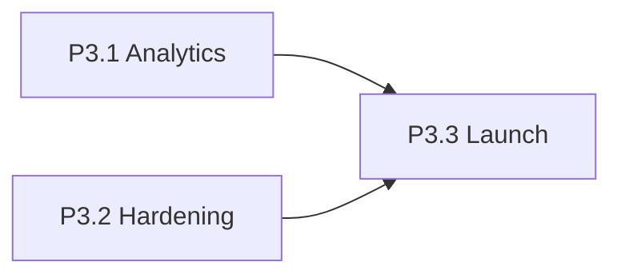

# VedaAcademy Enrolment — Phase 3: Scale, Polish & Launch

**Document Version:** 1.0
**Date:** October 2026
**Status:** Draft — planning artifact
**Audience:** Development team, DevOps, QA, security reviewers
**Related:** [../MASTER_ROADMAP.md](../MASTER_ROADMAP.md), [../IMPLEMENTATION_CHECKLIST.md](../IMPLEMENTATION_CHECKLIST.md)

---

## Table of Contents

1. [Overview](#1-overview)
2. [P3.1 — Analytics and dashboards](#2-p31--analytics-and-dashboards)
3. [P3.2 — Security and performance hardening](#3-p32--security-and-performance-hardening)
4. [P3.3 — Integration testing and go-live](#4-p33--integration-testing-and-go-live)
5. [Launch readiness checklist](#5-launch-readiness-checklist)
6. [Post-launch monitoring](#6-post-launch-monitoring)
7. [Phase 4+ deferred items](#7-phase-4-deferred-items)

---

## 1. Overview

Phase 3 is the final push from feature-complete to production-live. Three sub-slices run partially in parallel:



P3.1 and P3.2 can overlap because analytics and security work target different codepaths. P3.3 (launch) requires both to be complete.

---

## 2. P3.1 — Analytics and dashboards

**Duration:** Week 8
**Depends on:** Phase 2 complete (data flowing through all application paths)

### 2.1 School analytics dashboard

**Endpoint:** `GET /api/v1/staff/analytics`

| Metric | Visualisation | Data Source |
|--------|--------------|-------------|
| Application funnel | Horizontal funnel chart | `application_schools` grouped by status |
| Applications over time | Line chart (daily/weekly) | `application_schools.submitted_at` |
| Applications by grade | Bar chart | `applications.form_data->>'grade_applying_for'` |
| Average response time | Stat card | `review_actions.performed_at` − `application_schools.submitted_at` |
| Pending applications | Stat card with alert | `application_schools WHERE status = 'pending'` |
| Approval rate | Percentage stat card | approved / (approved + rejected) |
| Most requested documents | Table | `info_requests.documents_requested` aggregated |

#### School dashboard wireframe

```
┌────────────────────────────────────────────────────────────────────┐
│  School Analytics Dashboard                          [Export CSV]  │
├────────────────────────────────────────────────────────────────────┤
│                                                                     │
│  ┌──────────┐ ┌──────────┐ ┌──────────┐ ┌──────────┐              │
│  │ Total    │ │ Pending  │ │ Approved │ │ Avg Resp │              │
│  │ 142      │ │ 38       │ │ 67%      │ │ 3.2 days │              │
│  └──────────┘ └──────────┘ └──────────┘ └──────────┘              │
│                                                                     │
│  ┌────────────────────────────────────────────────────────────┐    │
│  │  Application Funnel                                         │    │
│  │  Submitted (142) → Reviewed (104) → Approved (95)          │    │
│  │                                    → Rejected (9)           │    │
│  │                   → Info Req (23)  → Responded (18)         │    │
│  │                   → Pending (15)                             │    │
│  └────────────────────────────────────────────────────────────┘    │
│                                                                     │
│  ┌──────────────────────┐  ┌──────────────────────────────────┐    │
│  │ By Grade             │  │ Over Time (last 30 days)          │    │
│  │ ███████ Grade 1: 35  │  │ ┌──────────────────────────────┐ │    │
│  │ █████ Grade 2: 28    │  │ │  📈 line chart                │ │    │
│  │ ████ Grade 3: 22     │  │ └──────────────────────────────┘ │    │
│  │ ███ KG: 18           │  │                                   │    │
│  └──────────────────────┘  └──────────────────────────────────┘    │
│                                                                     │
└────────────────────────────────────────────────────────────────────┘
```

### 2.2 Parent application tracker

Enhanced parent dashboard with per-school status timeline:

```
┌────────────────────────────────────────────────────────────────────┐
│  My Applications                                                    │
├────────────────────────────────────────────────────────────────────┤
│                                                                     │
│  📝 Application: Arun Kumar — Grade 5                              │
│  Submitted: Oct 15, 2026                                           │
│                                                                     │
│  ┌──────────────────────────────────────────────────────────────┐  │
│  │ Delhi Public School        ● Approved (Oct 20)              │  │
│  │ ─────○─────○─────●                                          │  │
│  │ Submitted  Reviewed  Approved                               │  │
│  ├──────────────────────────────────────────────────────────────┤  │
│  │ Ryan International         ● Info Requested (Oct 18)        │  │
│  │ ─────○─────●                                                │  │
│  │ Submitted  Info Req  [Respond Now]                          │  │
│  ├──────────────────────────────────────────────────────────────┤  │
│  │ Kendriya Vidyalaya         ○ Pending                        │  │
│  │ ─────○                                                      │  │
│  │ Submitted                                                   │  │
│  └──────────────────────────────────────────────────────────────┘  │
│                                                                     │
└────────────────────────────────────────────────────────────────────┘
```

### 2.3 Platform analytics

**Endpoint:** `GET /api/v1/platform/analytics` (platform admin only)

| Metric | Description |
|--------|-------------|
| Total schools registered | Count of schools by status |
| Total parents registered | Count of verified parents |
| Total applications | By status, by method (school-first vs agentic) |
| Conversion funnel | Registration → profile complete → application started → submitted |
| Top schools by applications | Ranked list |
| Geographic distribution | Applications by city/state |
| Weekly growth | New schools, parents, applications week-over-week |

---

## 3. P3.2 — Security and performance hardening

**Duration:** Week 9
**Depends on:** Phase 2 complete (all endpoints exist)

### 3.1 Security audit checklist

| # | Category | Check | Status |
|---|----------|-------|--------|
| S1 | **Authentication** | Bcrypt cost factor ≥ 12 | [ ] |
| S2 | | JWT RS256 signing; no HS256 | [ ] |
| S3 | | Refresh token rotation on use | [ ] |
| S4 | | Session timeout enforced (4h staff, 24h parent) | [ ] |
| S5 | **Authorisation** | School-scoped queries enforced at service layer | [ ] |
| S6 | | RBAC tested: viewer cannot perform review actions | [ ] |
| S7 | | Parent cannot access other parent's applications | [ ] |
| S8 | | Platform admin cannot see individual application data | [ ] |
| S9 | **Input validation** | All endpoints use Pydantic strict mode | [ ] |
| S10 | | SQL injection test suite passes | [ ] |
| S11 | | XSS test suite passes (stored + reflected) | [ ] |
| S12 | | CSRF protection on state-changing endpoints | [ ] |
| S13 | **File upload** | MIME type validated server-side (not just extension) | [ ] |
| S14 | | File size limits enforced (5 MB) | [ ] |
| S15 | | Uploaded files not executable | [ ] |
| S16 | | Signed URLs expire after 1 hour | [ ] |
| S17 | **Transport** | HTTPS enforced; HTTP redirects to HTTPS | [ ] |
| S18 | | TLS 1.2+ only; no legacy protocols | [ ] |
| S19 | | Security headers: CSP, X-Frame-Options, X-Content-Type-Options | [ ] |
| S20 | **Rate limiting** | Auth endpoints: 5/15min per IP | [ ] |
| S21 | | Application submit: 10/hour per user | [ ] |
| S22 | | Search: 60/min per user | [ ] |
| S23 | | Rate limit responses include Retry-After header | [ ] |
| S24 | **Data** | Passwords hashed with bcrypt (never logged) | [ ] |
| S25 | | PII not logged (email, phone, names) | [ ] |
| S26 | | Database encryption at rest (Neon default) | [ ] |
| S27 | | R2 server-side encryption enabled | [ ] |

### 3.2 Performance benchmarks

| Endpoint | p50 Target | p95 Target | p99 Target | Test Method |
|----------|-----------|-----------|-----------|-------------|
| `GET /health` | < 5ms | < 10ms | < 50ms | Baseline |
| `POST /auth/login` | < 150ms | < 300ms | < 500ms | bcrypt is intentionally slow |
| `GET /schools/search` | < 50ms | < 200ms | < 500ms | With 1,000 schools |
| `GET /staff/applications` | < 50ms | < 150ms | < 300ms | With 500 applications |
| `POST /applications` | < 100ms | < 200ms | < 500ms | With document references |
| `POST /applications/submit-multi` | < 200ms | < 500ms | < 1s | 5 schools |
| `POST /chatbot/respond` | < 2s | < 3s | < 5s | Including LLM call |
| `GET /staff/analytics` | < 200ms | < 500ms | < 1s | Aggregation queries |

### 3.3 Performance optimisation tasks

- [ ] Add composite indexes for common query patterns
- [ ] EXPLAIN ANALYSE on all analytics queries
- [ ] Redis caching for school search (TTL 5 min)
- [ ] Redis caching for school detail (TTL 15 min)
- [ ] Connection pooling: min=2, max=10 (Neon serverless)
- [ ] Response compression (gzip) for > 1 KB responses
- [ ] Frontend: lazy loading for school comparison images
- [ ] Frontend: pagination with virtual scrolling for large lists
- [ ] Database vacuum and analyse schedule

### 3.4 Load testing plan

| Scenario | Concurrent Users | Duration | Success Criteria |
|----------|-----------------|----------|------------------|
| Parent browse + search | 100 parents | 15 min | p95 < 300ms; 0 errors |
| Application submission burst | 50 parents submitting | 10 min | p95 < 500ms; 0 errors |
| Mixed parent + staff | 100 parents + 20 staff | 15 min | p95 < 300ms; 0 errors |
| Peak load | 200 parents + 50 staff | 30 min | p95 < 500ms; < 0.1% errors |
| Sustained load | 500 applications/hour | 2 hours | No memory leaks; stable latency |

---

## 4. P3.3 — Integration testing and go-live

**Duration:** Week 10
**Depends on:** P3.1 + P3.2 complete

### 4.1 End-to-end test scenarios

| # | Scenario | Steps | Validates |
|---|----------|-------|-----------|
| E1 | Parent school-first flow | Register → verify → profile → search → apply → submit | Core happy path |
| E2 | School review flow | Onboard school → staff login → view apps → approve | School side happy path |
| E3 | Agentic multi-school flow | Register → chatbot → review → select schools → submit | Phase 2 path |
| E4 | Info request cycle | Staff requests info → parent responds → staff re-reviews | Communication loop |
| E5 | Embed link flow | Click embed link → redirect → register → apply to that school | Website integration |
| E6 | Rejection flow | Staff rejects with reason → parent receives email with reason | Negative path |
| E7 | Multi-school mixed review | Submit to 3 schools → S1 approves, S2 rejects, S3 requests info | Independent per-school |
| E8 | Concurrent review | Two staff review same app simultaneously → optimistic lock | Conflict handling |
| E9 | Profile gate | Login with incomplete profile → forced to profile page | Access control |
| E10 | Rate limiting | Exceed login attempts → 429 response with Retry-After | Security enforcement |

### 4.2 Deployment checklist

#### Staging
- [ ] Staging environment provisioned (Fly.io staging app)
- [ ] Staging database with seed data (10 schools, 50 applications)
- [ ] Staging domain configured (staging.smartschooladmissions.com)
- [ ] All E2E tests pass on staging
- [ ] Load test pass on staging
- [ ] Manual QA walkthrough on staging

#### Production
- [ ] Production Fly.io app created
- [ ] Production Neon database provisioned
- [ ] Production Upstash Redis provisioned
- [ ] Production R2 bucket created
- [ ] Production Resend domain verified (smartschooladmissions.com)
- [ ] DNS: smartschooladmissions.com → Fly.io app
- [ ] TLS certificate provisioned and verified
- [ ] Environment variables set (all secrets via Fly.io secrets)
- [ ] Alembic migrations run on production database
- [ ] Health check endpoint responds 200
- [ ] Smoke test: register → verify → login → search → submit
- [ ] Monitoring configured (see §6)

### 4.3 Go-live runbook

| Step | Action | Rollback |
|------|--------|----------|
| 1 | Deploy API to production | `fly deploy --image previous_tag` |
| 2 | Run database migrations | Manual rollback migration |
| 3 | Deploy frontend to production | `fly deploy --image previous_tag` |
| 4 | Switch DNS to production | Revert DNS records |
| 5 | Smoke test (5 min) | Halt if failures |
| 6 | Monitor dashboards (30 min) | Rollback if error rate > 1% |
| 7 | Announce launch | N/A |

---

## 5. Launch readiness checklist

### Functional readiness
- [ ] All Phase 1 features working end-to-end
- [ ] All Phase 2 features working end-to-end
- [ ] All E2E test scenarios passing
- [ ] Email notifications delivering correctly

### Security readiness
- [ ] Security audit checklist (§3.1) — all items checked
- [ ] No critical or high vulnerabilities open
- [ ] Rate limiting verified under load
- [ ] RBAC verified: school isolation, parent isolation

### Performance readiness
- [ ] Performance benchmarks (§3.2) — all targets met
- [ ] Load test (§3.4) — peak scenario passes
- [ ] No memory leaks under sustained load
- [ ] Database query plans optimised

### Operations readiness
- [ ] Monitoring + alerting configured
- [ ] Runbook documented
- [ ] Backup strategy verified (daily DB backup)
- [ ] On-call rotation defined
- [ ] Incident response process defined
- [ ] Status page configured

### Documentation readiness
- [ ] API documentation (Swagger/OpenAPI) live
- [ ] School onboarding guide ready
- [ ] Embed link integration guide for schools ready
- [ ] Parent FAQ / help page ready

---

## 6. Post-launch monitoring

### 6.1 Monitoring stack

| Component | Tool | Metric |
|-----------|------|--------|
| Uptime | Fly.io health checks | HTTP 200 on /health every 30s |
| Errors | Sentry | Exception tracking; alert on new errors |
| Logs | Fly.io log drain → Logtail | Structured JSON logs; search + alert |
| Metrics | Fly.io built-in | CPU, memory, request count, latency |
| Email delivery | Resend dashboard | Delivery rate, bounce rate |
| Database | Neon dashboard | Connections, query time, storage |

### 6.2 Alert thresholds

| Metric | Warning | Critical |
|--------|---------|----------|
| Error rate (5xx) | > 1% over 5 min | > 5% over 5 min |
| p95 latency | > 500ms over 5 min | > 1s over 5 min |
| Uptime | < 99.5% over 24h | < 99% over 1h |
| Email delivery rate | < 95% over 1h | < 90% over 1h |
| Database connections | > 80% of pool | > 95% of pool |

---

## 7. Phase 4+ deferred items

| Feature | Description | Estimated Phase |
|---------|-------------|-----------------|
| Payment processing | Application fee collection via Razorpay/Stripe | Phase 4 |
| Waitlist management | School-defined capacity; automatic waitlisting | Phase 4 |
| Sibling linking | Family accounts; sibling preference scoring | Phase 4 |
| Veda School data sync | Admitted students sync to Veda School SIS | Phase 4 |
| Push notifications | Mobile push via FCM/APNs | Phase 4 |
| SMS notifications | Twilio/MSG91 for Indian mobile numbers | Phase 4 |
| Multi-language support | Hindi, Tamil, Telugu, Kannada | Phase 5 |
| School self-serve onboarding | Schools register themselves (with verification) | Phase 4 |
| Advanced AI matching | AI recommends schools based on student profile | Phase 5 |
| Alumni tracking | Track admitted students' journey | Phase 6 |

---

**Last Updated:** October 24, 2026
**Version:** 1.0
**Status:** Draft — planning artifact
