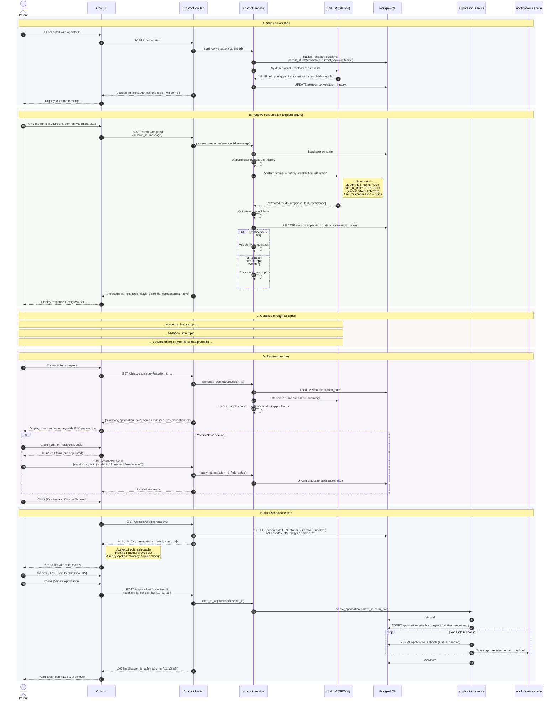
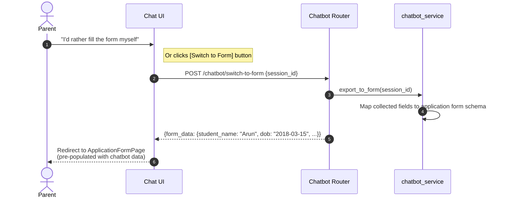
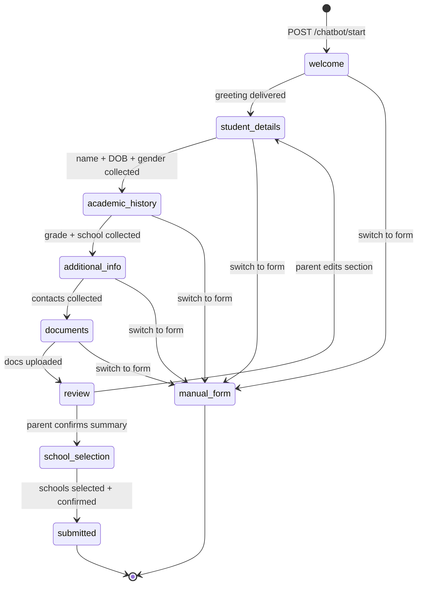

# Application-First (Agentic) Flow — Sequence Diagram

**Companion to:** [../ARCHITECTURE_AND_FLOWS.md](../ARCHITECTURE_AND_FLOWS.md) §3, [../Phase2/PHASE2_ENHANCEMENTS.md](../Phase2/PHASE2_ENHANCEMENTS.md) §2
**Status:** Draft — planned for Phase 2 (P2.1–P2.2)
**Sub-slice:** P2.1, P2.2

## Business summary

Instead of navigating a form, the parent has a guided conversation with an AI chatbot. The chatbot collects all application data through natural dialogue, produces a structured summary for review, and then presents eligible schools for multi-school selection. The parent can switch to the manual form at any point (pre-populated with data collected so far).

## Sequence

## Fallback: switch to manual form

## Conversation state transitions

## Error handling

| Condition | Behavior |
|-----------|----------|
| LLM timeout (> 10s) | Retry once; if still fails, show "I'm having trouble. Try again or switch to the form." |
| LLM extraction confidence < 0.5 | Ask specific clarifying question (not open-ended) |
| LLM produces invalid data (e.g., future DOB) | Validate + ask parent to correct |
| 3 consecutive extraction failures for same field | Auto-switch to inline form field for that item |
| Session idle > 30 min | Save state; parent can resume later |
| Browser closed mid-conversation | Session persisted in DB; resume on next visit |
