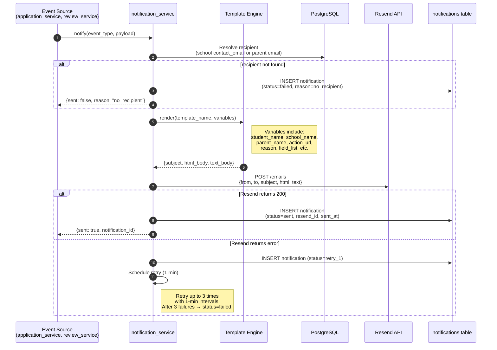
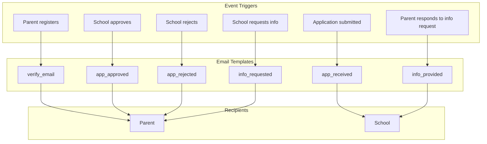
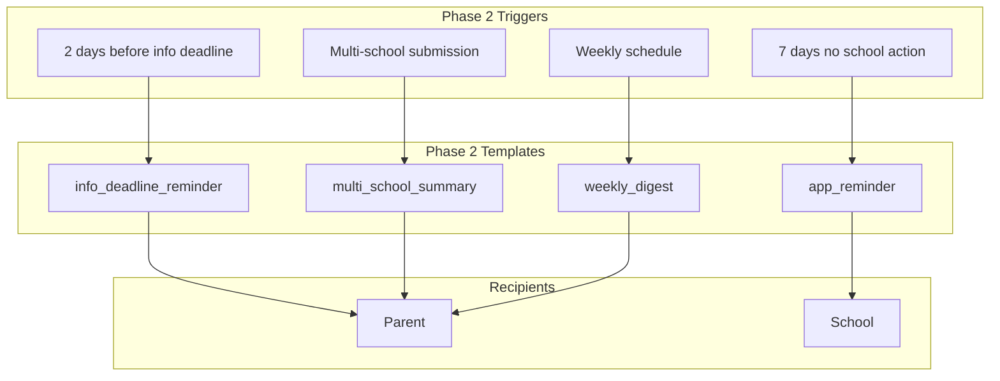
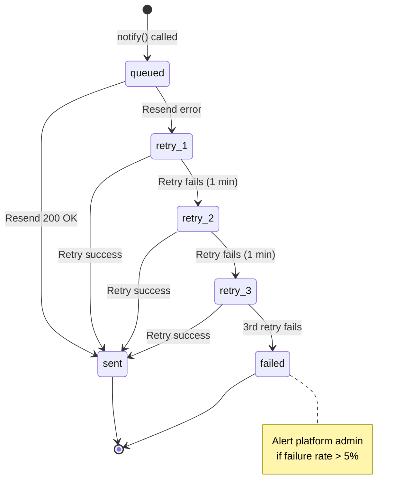

# Notification Pipeline — Sequence Diagram

**Companion to:** [../ARCHITECTURE_AND_FLOWS.md](../ARCHITECTURE_AND_FLOWS.md) §5
**Status:** Draft — matches planned implementation
**Sub-slice:** P1.4 (core), P2.3 (advanced)

## Business summary

Every significant event in the enrolment lifecycle triggers an email notification. The notification service resolves the recipient, selects the template, renders it with event-specific variables, and dispatches via Resend. All deliveries are logged for audit and retry. Phase 2 adds automated reminders and configurable notification preferences.

## Core notification sequence



## Notification templates

### Phase 1 templates



### Phase 2 additional templates



## Template variable reference

| Template | Variables |
|----------|----------|
| `verify_email` | `parent_name`, `verify_url` (24h expiry token) |
| `app_received` | `school_name`, `student_name`, `grade`, `parent_name`, `review_url` (signed link) |
| `app_approved` | `parent_name`, `student_name`, `school_name`, `notes` (optional) |
| `app_rejected` | `parent_name`, `student_name`, `school_name`, `reason` |
| `info_requested` | `parent_name`, `student_name`, `school_name`, `fields_list`, `documents_list`, `message`, `respond_url`, `deadline` (optional) |
| `info_provided` | `school_name`, `student_name`, `parent_name`, `review_url` |
| `app_reminder` | `school_name`, `student_name`, `days_pending`, `review_url` |
| `info_deadline_reminder` | `parent_name`, `school_name`, `deadline_date`, `respond_url` |
| `multi_school_summary` | `parent_name`, `student_name`, `schools_list` (names + statuses) |
| `weekly_digest` | `parent_name`, `applications` (array of {school, status, last_update}) |

## Secure link generation

All links in notification emails use signed tokens:

```
https://smartschooladmissions.com/review/{signed_token}

signed_token = base64url(
  HMAC-SHA256(
    key = APP_SECRET,
    data = {
      type: "review" | "respond" | "verify",
      target_id: uuid,
      recipient_id: uuid,
      issued_at: timestamp,
      expires_at: timestamp (optional)
    }
  )
) + "." + base64url(payload)
```

| Link Type | Expiry | Purpose |
|-----------|--------|---------|
| `verify` | 24 hours | Email verification |
| `review` | No expiry (requires login) | School staff review link |
| `respond` | No expiry (requires login) | Parent info-response link |
| `setup` | 24 hours | Staff account setup |

## Retry and failure handling



## Phase 2: automated reminders

| Reminder | Trigger | Frequency | Condition |
|----------|---------|-----------|-----------|
| School inaction | Cron job (daily) | Once per application | `application_schools.status = 'pending'` AND `submitted_at < NOW() - 7 days` AND no reminder sent in last 7 days |
| Info deadline | Cron job (daily) | Once per request | `info_requests.deadline IS NOT NULL` AND `deadline - NOW() < 2 days` AND `info_requests.status = 'pending'` |
| Weekly digest | Cron job (weekly, Monday 9am) | Once per parent | Parent has `notification_preferences.frequency = 'weekly'` AND has active applications |
