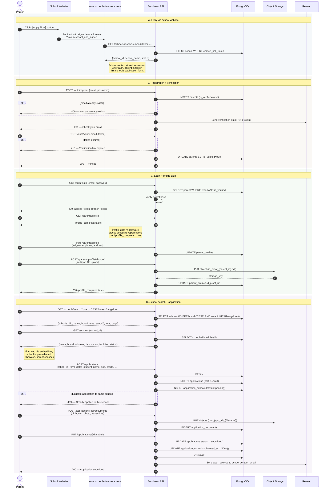

# Parent Application Flow — School-First (Sequence Diagram)

**Companion to:** [../ARCHITECTURE_AND_FLOWS.md](../ARCHITECTURE_AND_FLOWS.md) §2
**Status:** Draft — matches planned implementation
**Sub-slice:** P1.2–P1.3

## Business summary

A parent arrives via a school's "Apply Now" embed link or directly at smartschooladmissions.com. They register, verify email, complete their profile, search for schools, and submit an application. The embed link pre-selects the school; direct visitors use the search flow.

## Sequence

## Error codes raised

| Code | HTTP | Condition |
|------|------|-----------|
| `ACCOUNT_EXISTS` | 409 | Email already registered |
| `VERIFICATION_EXPIRED` | 410 | Verification token expired |
| `INVALID_CREDENTIALS` | 401 | Wrong email or password |
| `EMAIL_NOT_VERIFIED` | 403 | Attempting login before verification |
| `PROFILE_INCOMPLETE` | 403 | Attempting application access before profile completion |
| `DUPLICATE_APPLICATION` | 409 | Already applied to this school |
| `SCHOOL_NOT_ACTIVE` | 403 | Attempting to apply to inactive school |
| `INVALID_EMBED_TOKEN` | 400 | Embed link token invalid or revoked |
