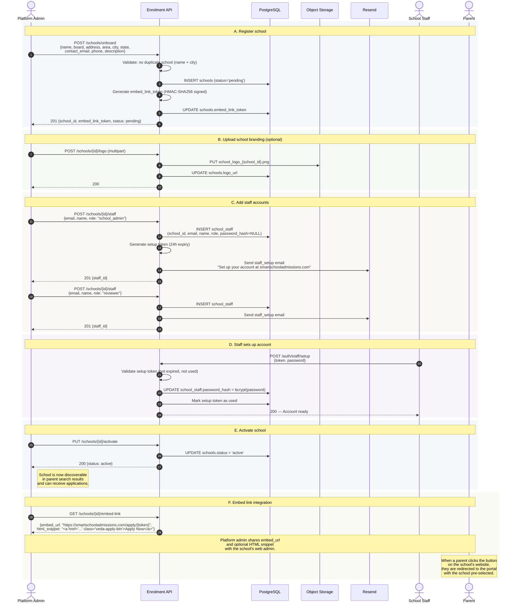
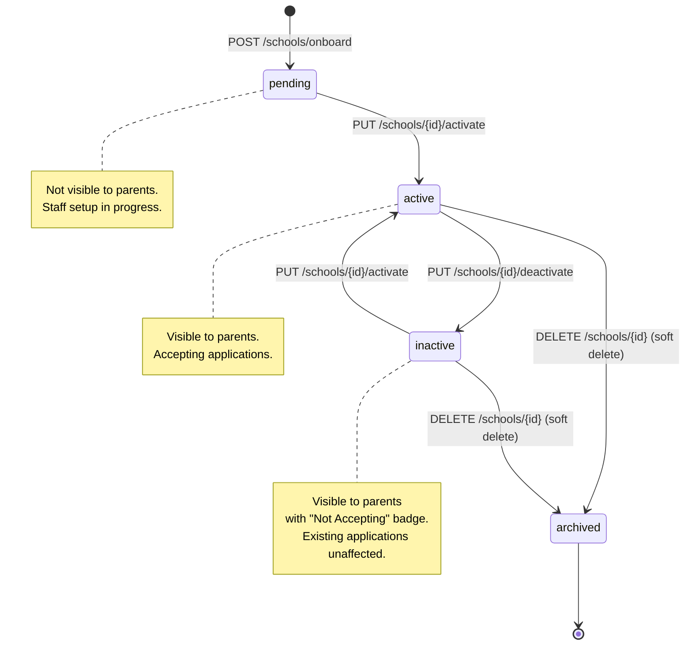

# School Onboarding Flow — Sequence Diagram

**Companion to:** [../ARCHITECTURE_AND_FLOWS.md](../ARCHITECTURE_AND_FLOWS.md) §6
**Status:** Draft — matches planned implementation
**Sub-slice:** P1.4

## Business summary

School onboarding is a one-time process. A platform administrator registers the school, adds staff accounts, and generates a secure embed link. Staff receive a setup email to create their password. The school places the embed link as an "Apply Now" button on their website. This is the only path to create a school in the enrolment system — there is no school self-registration in Phase 1.

## Sequence

## School status lifecycle

## Onboarding data collected

| Field | Required | Validation |
|-------|----------|------------|
| `name` | Yes | 2–200 characters; unique per city |
| `board` | Yes | Enum: CBSE, ICSE, Matriculation, State Board, International, Other |
| `address` | Yes | Max 500 characters |
| `area` | Yes | Max 100 characters (locality/neighbourhood) |
| `city` | Yes | Max 100 characters |
| `state` | Yes | Max 100 characters |
| `contact_email` | Yes | Valid email; receives application notifications |
| `phone` | Yes | E.164 or Indian format |
| `description` | No | Max 2,000 characters |
| `facilities` | No | JSONB array of strings |
| `fee_range` | No | Free text (e.g., "₹50K–₹80K/year") |
| `grades_offered` | No | JSONB array (e.g., ["KG", "Grade 1", ..., "Grade 12"]) |
| `website_url` | No | Valid URL |

## Staff roles created during onboarding

| Role | Permissions | Typical Staff |
|------|------------|---------------|
| `school_admin` | Full access: manage school settings, manage staff, review all applications | Principal, registrar |
| `reviewer` | View + act on applications (approve, reject, request info) | Admissions coordinator |
| `viewer` | Read-only access to applications | Office staff, teachers with read access |
