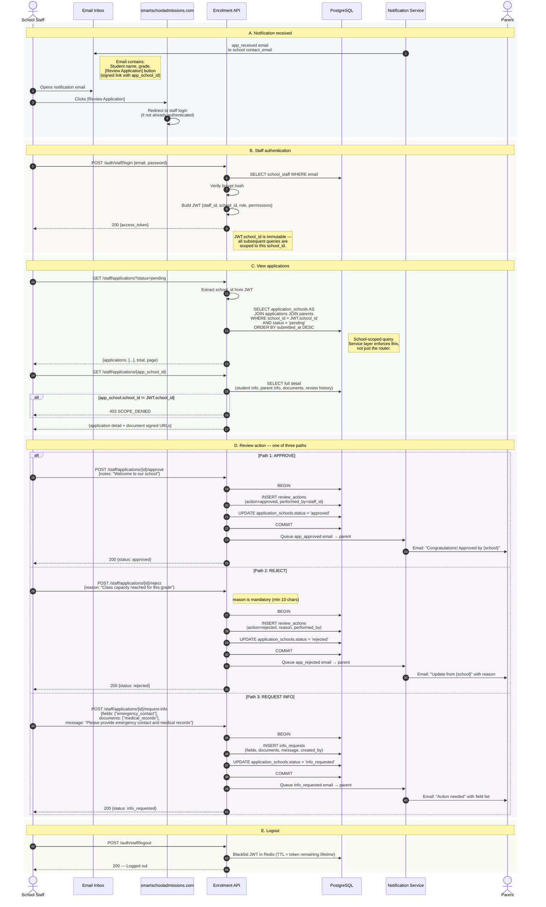

# School Application Review Flow — Sequence Diagram

**Companion to:** [../ARCHITECTURE_AND_FLOWS.md](../ARCHITECTURE_AND_FLOWS.md) §4
**Status:** Draft — matches planned implementation
**Sub-slice:** P1.4

## Business summary

When a parent submits an application, the school's registered contact email receives a notification with a secure review link. School staff log in, view applications scoped to their school only, and take one of three actions: approve, reject (with mandatory reason), or request additional information. All actions are append-only in the review history. One school's staff cannot see another school's applications.

## Sequence

## Permission enforcement

| Action | Required Role | Permission Key |
|--------|--------------|----------------|
| View application list | viewer, reviewer, school_admin | `applications:read` |
| View application detail | viewer, reviewer, school_admin | `applications:read` |
| Approve application | reviewer, school_admin | `applications:review` |
| Reject application | reviewer, school_admin | `applications:review` |
| Request additional info | reviewer, school_admin | `applications:review` |
| Manage school settings | school_admin | `school:manage` |

## Error codes raised

| Code | HTTP | Condition |
|------|------|-----------|
| `INVALID_CREDENTIALS` | 401 | Wrong email or password |
| `SCOPE_DENIED` | 403 | Accessing application from another school |
| `FORBIDDEN_PERMISSION` | 403 | Viewer attempting review action |
| `INVALID_APPLICATION_STATUS` | 409 | Attempting action on already-finalised application |
| `REASON_REQUIRED` | 422 | Reject without reason or reason < 10 chars |
| `OPTIMISTIC_LOCK_CONFLICT` | 409 | Another staff member acted on same application concurrently |
